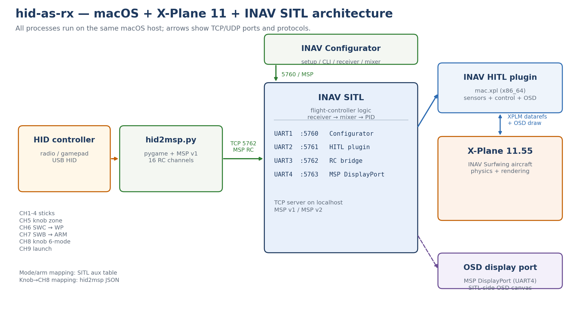
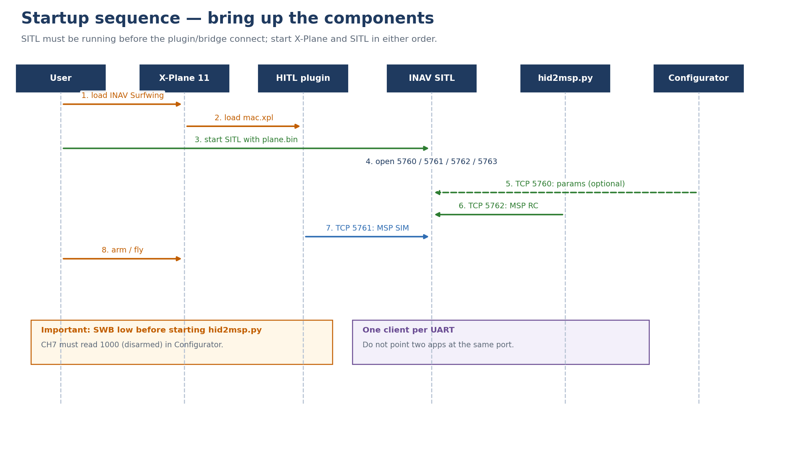
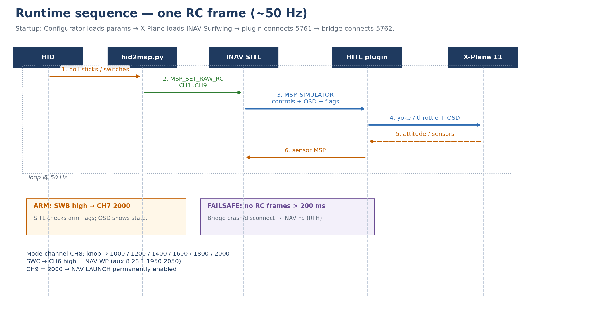

# hid-as-rx

在 macOS 上用 **HID 手柄/遥控器** 当接收机，驱动 **INAV SITL**，并把 **X-Plane 11** 当作飞行仿真器。

这个项目不是给真机刷固件，而是一套 **SITL + HITL 桌面仿真环境**：

- X-Plane 提供飞机物理、画面和 OSD 显示；
- INAV SITL 提供真实的飞控逻辑（接收机、混控、PID、导航、模式）；
- HID 手柄/遥控器通过 `hid2msp.py` 变成 INAV 的 **MSP 接收机**；
- INAV Configurator 用来配置 SITL 里的“飞控”。

> 当前验证环境：macOS 26.3.1 arm64、X-Plane 11.55r2（Steam）、INAV Configurator 9.0.0、INAV SITL 9.0.0、Python 3.10 + pygame 2.1.2。

---

## 0. 最快启动

```bash
cd "$HOME/Desktop/Read-the-Source-Code/hid-as-rx"

# 单入口：默认启动 SITL + bridge，后台运行并打印状态摘要
./hidctl start

# 看状态
./hidctl status
```

然后：

1. X-Plane 11 加载 **INAV Surfwing**；
2. `Plugins → INAV HITL/SITL → Connect to SITL → 127.0.0.1:5761`；
3. 需要改参数时，Configurator 用 **TCP 127.0.0.1:5760** 连接；
4. 启动桥前先把 **SWB 拨到低位**，避免自动解锁。

X-Plane 不由 `hidctl` 管理；它只负责 SITL 和手柄桥。

更详细的安装、配置和排错见下文。

---

## 1. 系统组成

### 1.1 必须安装/准备的组件

| 组件 | 版本/位置 | 作用 | 是否必须 |
|---|---|---|---|
| **macOS** | 13+，本项目在 26.3.1 验证 | 宿主系统 | 是 |
| **X-Plane 11** | 11.55r2，Steam 版 | 飞机物理、渲染、HITL 插件宿主 | 是 |
| **INAV Configurator** | 9.0.0 | 配置 SITL；自带 macOS SITL 二进制 | 是 |
| **INAV SITL** | 9.0.0，Configurator 内置 | 运行飞控逻辑 | 是 |
| **INAV HITL 插件 + INAV Surfwing** | `3rdparty/INAV-X-Plane-HITL/release/` | 把 X-Plane 传感器/控制/OSD 接到 SITL | 是 |
| **Python 3** | 3.10+ | 运行 `hid2msp.py` 和标定脚本 | 是 |
| **pygame** | 2.x | 读取 HID 手柄/遥控器；键盘模式不需要 | HID 时是 |
| **HID 手柄/遥控器** | USB HID | 提供 AETR、旋钮、开关 | 可选；没有时用键盘 |
| **INAV Configurator 的 SITL 二进制** | `.../Contents/Resources/sitl/macos/inav_SITL` | 实际运行的 SITL | 是 |

**不需要：**

- 不需要真实飞控；
- 不需要真实接收机；
- 不需要自己编译 SITL；
- 不需要自己编译 HITL 插件（用 release 里的 `mac.xpl`）；
- 不需要改真实飞机的 INAV 配置。

### 1.2 组件协作关系





四个 TCP 服务都在本机：

| 端口 | SITL UART | 客户端 | 协议/用途 |
|---|---|---|---|
| `5760` | UART1 | INAV Configurator | MSP 配置、CLI |
| `5761` | UART2 | X-Plane HITL 插件 | `MSP_SIMULATOR`：传感器 + 控制 + OSD |
| `5762` | UART3 | `hid2msp.py` | `MSP_SET_RAW_RC`：RC 通道 |
| `5763` | UART4 | 无（SITL 自己输出） | MSP DisplayPort / HD OSD |

关键点：

- **每个 UART 同时只能有一个 TCP 客户端**，所以 Configurator、插件、手柄桥必须各占一个 UART。
- HID 手柄不是 X-Plane 的摇杆，而是通过 `hid2msp.py` 变成 INAV 的 MSP 接收机。
- X-Plane 里的飞机由 HITL 插件控制；插件把 SITL 的 roll/pitch/yaw/throttle 写进 X-Plane。
- OSD 由 HITL 插件绘制；SITL 用 UART4 的 MSP DisplayPort 维护 OSD 画布，插件通过 5761 的 MSP_SIMULATOR 读取并绘制。

### 1.3 运行时序



一次 50 Hz 的循环：

1. `hid2msp.py` 读取 HID 的轴/按键；
2. 通过 `5762` 发 `MSP_SET_RAW_RC`（CH1–CH9）；
3. SITL 做接收机解析、混控、PID、导航；
4. SITL 通过 `5761` 回 `MSP_SIMULATOR`（控制量、OSD、状态位）；
5. HITL 插件把控制量写进 X-Plane，并绘制 OSD；
6. X-Plane 把姿态/传感器数据回传给插件，插件再通过 MSP 回给 SITL。

---

## 2. 目录和文件

> 本仓库只包含 `hid-as-rx` 自己的代码、配置和文档；不包含三个上游源码仓库。首次使用请在同级目录单独准备：
>
> ```bash
> cd 3rdparty
> git clone https://github.com/RomanLut/INAV-X-Plane-HITL.git
> git clone https://github.com/iNavFlight/inav.git                  # 仅源码参考，可选
> git clone https://github.com/iNavFlight/inav-configurator.git     # 仅源码参考，可选
> ```
>
> 运行时真正需要的是 **`3rdparty/INAV-X-Plane-HITL` 的 `release/`** 和 **INAV Configurator 9.0.0 应用**。

### 2.1 配置文件分类

| 分类 | 文件/位置 | 谁读取 | 作用 |
|---|---|---|---|
| **SITL 运行时配置** | `config/runtime/plane.bin` | SITL 每次启动读取 | 真正的飞控 eeprom，所有 `set/serial/aux/osd` 最终都在这里 |
| **SITL 源配置** | [INAV_SITL_MINIMAL_NODEFAULTS.txt](config/INAV_SITL_MINIMAL_NODEFAULTS.txt) | 人/Configurator CLI | 可读写的 CLI 源文件；加载进 eeprom 后才生效 |
| **HID 映射** | [hid2msp_inav.json](config/hid2msp_inav.json) | `scripts/hid2msp.py` 每次启动 | 轴/按键 → CH1–CH9、六段模式、CH9 常高 |
| **通用示例** | [hid2msp.example.json](config/hid2msp.example.json) | 仅参考 | Xbox 风格示例，不是当前配置 |
| **标定结果** | `config/calibration.json` | 人/`scripts/calibrate_hid.py` | 可选；脚本生成，已被 `.gitignore` 忽略 |
| **统一入口** | [hidctl](hidctl) | 人 | 启停 SITL/bridge、状态、日志、备份、恢复、重置 |
| **文档/图** | `README.md`、`docs/SOLUTION.md`、`docs/*.png` | 人 | 说明与架构/时序图 |
| **上游仓库** | `3rdparty/inav/`、`3rdparty/inav-configurator/`、`3rdparty/INAV-X-Plane-HITL/` | 不参与运行 | 本地参考；`.gitignore` 排除 |

已删除的旧文件（避免误用）：

- `INAV_SITL_6modes.txt`（旧 SWA 3×2 版本）
- `INAV_SITL_MINIMAL.txt`（带 `defaults noreboot` 的旧重载版本）
- `hid2msp_inav.example.json`（旧模板）
- 开发期 `.sitl/` 下的日志、备份和临时脚本（已删除）

### 2.2 文件清单

| 文件 | 作用 |
|---|---|
| [README.md](README.md) | 本文件：安装、启动、配置、排错 |
| [SOLUTION.md](docs/SOLUTION.md) | 更完整的调研、方案 A/B/C/D、HITL 适配评估 |
| [hid2msp.py](scripts/hid2msp.py) | HID/键盘 → MSP 接收机桥 |
| [keyboard_input.py](scripts/keyboard_input.py) | macOS 键盘输入、键位映射、键盘通道生成 |
| [hid2msp_inav.json](config/hid2msp_inav.json) | **当前实际使用**的手柄/遥控器映射 |
| [hid2msp.example.json](config/hid2msp.example.json) | 通用 Xbox 风格示例 |
| [calibrate_hid.py](scripts/calibrate_hid.py) | 交互式摇杆标定脚本 |
| [INAV_SITL_MINIMAL_NODEFAULTS.txt](config/INAV_SITL_MINIMAL_NODEFAULTS.txt) | **唯一 SITL CLI 源配置** |
| [hidctl](hidctl) | 统一入口：启停、状态、日志、备份、恢复、重置 |
| `docs/architecture.png` | 架构图 |
| `docs/startup.png` | 启动时序图 |
| `docs/sequence.png` | 运行时序图 |
| `docs/make_diagrams.py` | 重新生成三张图 |
| `config/runtime/plane.bin` | SITL 运行时 eeprom（配置真正生效的地方） |
| `config/runtime/backups/` | eeprom 备份（运行时生成，已忽略） |

> `config/runtime/` 是运行时目录，不是源码。不要直接编辑 `plane.bin`，用 Configurator/CLI 修改。

---

## 3. 安装

### 3.1 X-Plane 11

1. 安装/确认 **X-Plane 11.55r2**（Steam 或独立版均可）。
2. 找到 X-Plane 根目录。Steam 版通常是：

```text
~/Library/Application Support/Steam/steamapps/common/X-Plane 11
```

3. 复制 INAV Surfwing 飞机和插件：

```bash
XP="$HOME/Library/Application Support/Steam/steamapps/common/X-Plane 11"
cp -R "3rdparty/INAV-X-Plane-HITL/release/Aircraft/Extra Aircraft/NK_FPVSurfwing" \
      "$XP/Aircraft/Extra Aircraft/"
```

4. 去掉 quarantine：

```bash
xattr -rd com.apple.quarantine \
  "$XP/Aircraft/Extra Aircraft/NK_FPVSurfwing"
```

5. 启动 X-Plane，进入：

```text
New Flight → Select Aircraft → Show extra aircraft from old versions
→ Extra Aircraft → INAV Surfwing
```

> `Show extra aircraft from old versions` 在 **Select Aircraft 窗口底部**，不在 `Settings → General`。

### 3.2 INAV Configurator 9.0.0

安装 macOS 版 INAV Configurator 9.0.0。它自带 SITL：

```text
/Applications/INAV Configurator 9.0.0.app/Contents/Resources/sitl/macos/inav_SITL
```

确认：

```bash
"/Applications/INAV Configurator 9.0.0.app/Contents/Resources/sitl/macos/inav_SITL" --help
```

应显示 `INAV 9.0.0 SITL`。

> 不要修改 `/Applications/INAV Configurator 9.0.0.app` 内的文件；本项目只调用它自带的 SITL。

### 3.3 Python 和 pygame

```bash
python3 -m pip install --upgrade pygame
python3 scripts/hid2msp.py --list
```

`--list` 会打印手柄名称、轴数/按键数，并实时显示：

```text
axes=[...] buttons=[...]
```

如果 macOS 拦截输入，给 Terminal/iTerm 打开：

```text
系统设置 → 隐私与安全性 → 输入监控
```

### 3.4 HID 设备（可选）

没有 HID 时直接用 [4.3 键盘控制](#43-键盘控制)，不需要额外安装键盘库。

当前验证设备：

```text
PengFei Model RC Simulator - XTR+G2+FMS Controller
6 axes, 4 buttons
```

设备可以是一个 USB 模拟器适配器，也可以是把遥控器当 USB HID 的设备。只要 `--list` 能看到，就能用。

---

## 4. 通道定义

### 4.1 当前 `hid2msp_inav.json`

| 通道 | 功能 | 来源 |
|---|---|---|
| CH1 | Roll | `axis 5` |
| CH2 | Pitch | `axis 0` |
| CH3 | Throttle | `axis 1` |
| CH4 | Yaw | `axis 4` |
| CH5 | 旋钮三档原始指示 | `axis 3`，`tri` |
| CH6 | SWC → NAV WP | `button 3`，高=开 |
| CH7 | SWB → ARM | `button 2`，高=解锁 |
| CH8 | 六段模式 | `axis 3`，`multi` 6 档 |
| CH9 | NAV LAUNCH | 常高 `2000` |

### 4.2 六段模式

| 旋钮位置 | CH8 | 模式 |
|---|---|---|
| 最低 | 1000 | ANGLE |
| 低 | 1200 | HORIZON |
| 中低 | 1400 | MANUAL |
| 中高 | 1600 | NAV CRUISE |
| 高 | 1800 | NAV POSHOLD |
| 最高 | 2000 | NAV RTH |

- **SWC 高**：额外打开 **NAV WP**（`aux 8 28 1 1950 2050`）。
- **SWB 高**：ARM（`aux 0 0 2 1950 2050`）。
- **CH9 常高**：NAV LAUNCH 永久启用（`aux 7 36 4 1950 2050`）。

> 安全提醒：NAV LAUNCH 永久启用意味着解锁后飞控会进入起飞模式。SITL 里没有物理危险，但真机配置绝对不要照搬；每次解锁前确认桨叶周围无人。

### 4.3 键盘控制

HID 手柄拔掉时，`keyboard.source = auto` 会自动改用键盘，不需要改启动命令。

默认键位：

| 键 | 功能 |
|---|---|
| `W` / `S` | Pitch 上 / 下 |
| `A` / `D` | Roll 左 / 右 |
| `Q` / `E` | Yaw 左 / 右 |
| `1`–`6` | 六段模式：ANGLE / HORIZON / MANUAL / CRUISE / POSHOLD / RTH |
| `Space` | 按一下切换解锁/上锁 |
| `Left Shift` | 按住增加油门 |
| `Left Fn` | 按住减少油门 |

行为：

- 初始油门 1000，CH7 上锁，CH8 为 ANGLE（1 档）。
- 解锁时如果油门 > 1050，会拒绝解锁并在日志里提示；先降到低位。
- `1`–`6` 是按下沿触发，不是按住。
- 轴和油门都按 `axis_rate` / `throttle_rate`（PWM/秒）平滑变化，不会瞬间满舵。
- 键盘模式不控制 CH6 NAV WP，CH6 固定 1000。

配置在 `config/hid2msp_inav.json`：

```json
"keyboard": {
  "enabled": true,
  "source": "auto",
  "axis_rate": 600,
  "throttle_rate": 600,
  "keys": {
    "roll_left": "a",
    "roll_right": "d",
    "pitch_up": "w",
    "pitch_down": "s",
    "yaw_left": "q",
    "yaw_right": "e",
    "arm": "space",
    "throttle_up": "left_shift",
    "throttle_down": "fn",
    "mode_1": "1",
    "mode_2": "2",
    "mode_3": "3",
    "mode_4": "4",
    "mode_5": "5",
    "mode_6": "6"
  }
}
```

`source` 三种值：

| 值 | 行为 |
|---|---|
| `auto` | 有 HID 用手柄，没有就用键盘 |
| `hid` | 强制手柄；没有手柄则启动失败 |
| `keyboard` | 强制键盘，即使手柄已连接 |

键名使用 macOS 虚拟键名，例如 `a`、`1`、`space`、`left_shift`、`left_option`、`left_control`、`fn`。配置错误会被 `./hidctl config check` 报出来。

#### macOS 权限

键盘是全局读键状态，不依赖窗口焦点。需要在：

```text
系统设置 → 隐私与安全性 → 辅助功能
系统设置 → 隐私与安全性 → 输入监控
```

TCC 是按**真正读取键盘的进程**算的，不是按脚本名算的。通过 `./hidctl start` 后台运行时，实际进程是 **Python**，不是 `hidctl` 脚本本身；只把 `hidctl` 加进输入监控可能不够。

建议同时添加：

```text
/Library/Frameworks/Python.framework/Versions/3.10/Resources/Python.app
```

以及启动它的程序：

- 从 Terminal/iTerm 运行：添加 **Terminal / iTerm**
- 从 DeepSeek Harness 运行：添加 **DeepSeek Harness**
- 如果列表里已经有 `hidctl`，可以保留，但不要只依赖它

添加/切换权限后要**重启 bridge**；必要时重启 Terminal 或 DeepSeek Harness。

检查：

```bash
./hidctl doctor
python3 scripts/hid2msp.py --keys
```

`--keys` 会实时打印键盘通道，不需要 SITL，适合先确认键位。

如果 `./hidctl doctor` 仍是 `FAIL keyboard input`：

1. 确认输入监控列表里有 **Python**（不是只有 `hidctl`）：
   ```text
   /Library/Frameworks/Python.framework/Versions/3.10/Resources/Python.app
   ```
2. 通过 DSH 运行时，再添加 **DeepSeek Harness**；通过 Terminal 运行时，添加 **Terminal/iTerm**。
3. **完全退出并重开** DeepSeek Harness 或 Terminal，然后重新执行：
   ```bash
   ./hidctl doctor
   ```
4. 还不行时，直接在 Terminal 里测试，排除 DSH 的 TCC 归属问题：
   ```bash
   cd "$HOME/Desktop/Read-the-Source-Code/hid-as-rx"
   python3 scripts/hid2msp.py --keys
   ```
   如果 Terminal 里能读到键、DSH 里不能，就用 Terminal 运行 `./hidctl start`，或把 DeepSeek Harness 加入输入监控。

#### Fn 键说明

macOS 的 `Fn` 有时不会产生普通 keycode；代码会额外检查 `kCGEventFlagMaskSecondaryFn`。如果仍然检测不到，把配置改成更可靠的键：

```json
"throttle_down": "left_option"
```

或 `"left_control"`，然后 `./hidctl restart bridge`。

---

## 5. 配置文件定义

### 5.1 `hid2msp_inav.json`

```json
{
  "host": "127.0.0.1",
  "port": 5762,
  "rate_hz": 50,
  "axes": [
    {"axis": 5, "channel": 1, "kind": "bipolar", "trim": 1500, "reverse": false},
    {"axis": 0, "channel": 2, "kind": "bipolar", "trim": 1500, "reverse": false},
    {"axis": 1, "channel": 3, "kind": "bipolar", "trim": 1500},
    {"axis": 4, "channel": 4, "kind": "bipolar", "trim": 1500},
    {"axis": 3, "channel": 8, "kind": "multi", "levels": 6,
     "values": [1000, 1200, 1400, 1600, 1800, 2000]},
    {"axis": 3, "channel": 5, "kind": "tri", "threshold": 0.0}
  ],
  "buttons": [
    {"button": 3, "channel": 6, "low": 1000, "high": 2000, "toggle": false},
    {"button": 2, "channel": 7, "low": 1000, "high": 2000, "toggle": false}
  ],
  "constants": {"9": 2000}
}
```

字段：

| 字段 | 说明 |
|---|---|
| `host` / `port` | SITL 的 RC UART（默认 `127.0.0.1:5762`） |
| `rate_hz` | RC 帧率，默认 50 Hz |
| `axes[].axis` | pygame/SDL 的轴编号，用 `--list` 确认 |
| `axes[].channel` | 目标 RC 通道（1–16） |
| `axes[].kind` | `bipolar`、`unipolar`、`tri`、`binary`、`multi` |
| `axes[].reverse` | 反向 |
| `axes[].trim` | 中位/低端 PWM |
| `axes[].deadband` / `expo` | 死区/曲线 |
| `axes[].threshold` | `tri`/`binary` 的切换阈值 |
| `axes[].levels` / `values` | `multi` 的档位数和每档 PWM |
| `buttons[].button` | 按键编号 |
| `buttons[].channel` | 目标通道 |
| `buttons[].low` / `high` | 松开/按下（或开关低/高）的 PWM |
| `buttons[].toggle` | `true` 为按一下切换，`false` 为跟随开关状态 |
| `constants` | 固定通道值；CH9=2000 就是 NAV LAUNCH |
| `keyboard` | 键盘控制：`enabled`、`source`（auto/hid/keyboard）、`axis_rate`、`throttle_rate`、`keys`；详见 4.3 |

`channel_map` 和 `mode_table` 只是文档字段，程序会忽略，方便人读。

> 同一个 `axis3` 同时给 CH8 做 6 档模式、给 CH5 做三档原始指示；CH5 不参与模式选择，可以删掉。


### 5.2 `INAV_SITL_MINIMAL_NODEFAULTS.txt`

这是 INAV CLI 配置，核心内容：

```text
# UART 映射（serial 的 id 从 0 开始）
# serial 0 = UART1 = 5760 Configurator
# serial 1 = UART2 = 5761 HITL 插件
# serial 2 = UART3 = 5762 手柄桥
# serial 3 = UART4 = 5763 MSP DisplayPort
serial 0 1 115200 115200 0 115200
serial 1 1 115200 115200 0 115200
serial 2 1 115200 115200 0 115200
serial 3 33554432 115200 115200 0 115200

set receiver_type = MSP
set gps_provider = FAKE
set acc_hardware = FAKE
set baro_hardware = FAKE
set mag_hardware = FAKE
set pitot_hardware = FAKE
set rangefinder_hardware = NONE
set opflow_hardware = NONE
set rssi_source = NONE
set osd_video_system = AVATAR

# aux 的第 3 个参数是 0 基通道号：
# 2 = CH7, 3 = CH8, 4 = CH9, 1 = CH6
aux 0 0 2 1950 2050   # CH7 SWB -> ARM
aux 1 1 3 950 1050    # CH8 1000 -> ANGLE
aux 2 2 3 1150 1250   # CH8 1200 -> HORIZON
aux 3 12 3 1350 1450  # CH8 1400 -> MANUAL
aux 4 53 3 1550 1650  # CH8 1600 -> NAV CRUISE
aux 5 11 3 1750 1850  # CH8 1800 -> NAV POSHOLD
aux 6 10 3 1950 2050  # CH8 2000 -> NAV RTH
aux 7 36 4 1950 2050  # CH9 2000 -> NAV LAUNCH
aux 8 28 1 1950 2050  # CH6 SWC -> NAV WP
```

`aux` 的模式编号是 INAV 的 **permanent ID**：

| permanent ID | 模式 |
|---|---|
| 0 | ARM |
| 1 | ANGLE |
| 2 | HORIZON |
| 12 | MANUAL |
| 53 | NAV CRUISE |
| 11 | NAV POSHOLD |
| 10 | NAV RTH |
| 36 | NAV LAUNCH |
| 28 | NAV WP |

### 5.3 SITL 每次启动到底读哪个文件

**SITL 启动时只读 `config/runtime/plane.bin`。**

```bash
./hidctl start sitl
# 等价于：
# inav_SITL --path="$PWD/config/runtime/plane.bin"
```

启动顺序和数据流：

```text
config/INAV_SITL_MINIMAL_NODEFAULTS.txt   （人可读的 CLI 源文件）
        │  只在 Configurator CLI 里手动粘贴/加载
        ▼
config/runtime/plane.bin                        （32 KB 飞控 eeprom）
        │  每次 SITL 启动 --path 读取
        ▼
INAV SITL 运行时配置
```

因此：

- 修改 `config/INAV_SITL_MINIMAL_NODEFAULTS.txt` **不会**自动影响正在运行的 SITL；必须重新在 CLI 里加载并 `save`，或重新生成 `config/runtime/plane.bin`。
- `hidctl` 不会读 `.txt`；它只把 `config/runtime/plane.bin` 传给 SITL 的 `--path`。
- 如果 `config/runtime/plane.bin` 不存在，SITL 会生成一份**默认配置**，不是本项目配置；需要按 7.7 加载 CLI。
- 不要直接编辑 `config/runtime/plane.bin`（二进制）；用 Configurator/CLI 修改后 `save`。
- 不要在 INAV 9 SITL 上反复执行 `defaults noreboot` + 连续灌 CLI；本次实际遇到过崩溃。需要重置时优先删除/备份 `config/runtime/plane.bin`，让 SITL 生成全新 eeprom，再加载 `config/INAV_SITL_MINIMAL_NODEFAULTS.txt`。

---

## 6. 启动、停止与重置

统一入口是 **`./hidctl`**，只管理两个组件：

| 组件 | 作用 |
|---|---|
| `sitl` | INAV SITL，读取 `config/runtime/plane.bin` |
| `bridge` | `scripts/hid2msp.py`，读取 `config/hid2msp_inav.json` |

**X-Plane 不由 `hidctl` 管理**；它只负责启动 SITL 和手柄桥。

### 6.1 启动

```bash
./hidctl start              # 默认 all：SITL + bridge
./hidctl start sitl         # 只启动 SITL
./hidctl start bridge       # 只启动 bridge
```

行为：

- 成功后默认打印状态摘要和日志路径；`--quiet` 可静默，错误写 stderr。
- 组件输出追加到 `logs/sitl.log`、`logs/bridge.log`。
- PID 写到 `run/sitl.pid`、`run/bridge.pid`。
- `start all` 先启动 SITL，等 5760/5761 就绪，再启动 bridge；SITL 起不来就不会启动 bridge。
- `start bridge` 时如果 SITL 没运行：只警告，bridge 仍然启动并不断重连 5762。
- 没有 HID 时，`keyboard.source=auto` 自动用键盘；如果 HID 和键盘都不可用，bridge 启动失败。
- `start` 是幂等的，已经在运行就跳过。
- 默认等同于 `./hidctl start --verbose`，会打印状态摘要和日志路径。
- 不需要输出时：
  ```bash
  ./hidctl start --quiet
  ```
- 想持续看组件输出：
  ```bash
  ./hidctl logs bridge -f
  ```

### 6.2 外部 UI 还要手动操作

1. 加载 **INAV Surfwing**（`Select Aircraft` 里勾选 `Show extra aircraft from old versions`）。
2. 连接插件：
   ```text
   Plugins → INAV HITL/SITL → Connect to SITL → 127.0.0.1:5761
   ```
3. 需要改参数时，Configurator 用 TCP `127.0.0.1:5760` 连接。

### 6.3 状态

```bash
./hidctl status
./hidctl status --json
```

示例：

```text
sitl    running  pid 12345  ports 5760,5761,5762,5763
bridge  running  pid 12346  target 127.0.0.1:5762  connected
eeprom  config/runtime/plane.bin  (32768 bytes, 2026-11-10 10:20:31)
config  config/hid2msp_inav.json
xplane  external (not managed)
```

- `bridge` 可能显示 `waiting`（SITL 没起或正在重连）或 `unknown`（无法用 `lsof` 判断）。
- 退出码：`0` 表示 SITL 正常运行且 bridge 已连接；否则 `1`。

### 6.4 日志

日志采用**追加**模式，不覆盖、不自动轮转。每次启动/停止会插入一行：

```text
===== 2026-11-10 10:56:00 start sitl =====
```

命令：

```bash
./hidctl logs sitl
./hidctl logs bridge -n 100
./hidctl logs sitl -f
./hidctl logs all -f
```

日志会持续增长；需要手动清理时：

```bash
rm -f logs/sitl.log logs/bridge.log
```

### 6.5 停止与重启

```bash
./hidctl stop               # 停 bridge，再停 SITL
./hidctl stop bridge
./hidctl stop sitl

./hidctl restart            # 全部重启
./hidctl restart sitl       # 只重启 SITL（bridge 保持并重连）
./hidctl restart bridge
```

`stop sitl` 只停 SITL，不停 bridge；bridge 会进入 `waiting` 状态并重试。

### 6.6 重置状态（不是 X-Plane 重置游戏）

#### A. 软重置 SITL（推荐）

```bash
./hidctl restart sitl
```

- eeprom 保留；
- 飞控状态清空：disarm、传感器重初始化、home/任务/failsafe 清空；
- X-Plane 不动；
- bridge 不重启，自动重连；
- 插件会断开，重新点 `Connect to SITL → 127.0.0.1:5761`。

#### B. 硬重置 eeprom

```bash
./hidctl reset eeprom --yes
./hidctl reset eeprom --yes --no-backup
```

行为：

1. 必须 `--yes`；
2. 停 bridge + SITL；
3. **默认备份**当前 `config/runtime/plane.bin`；`--no-backup` 才跳过；
4. 删除 eeprom；
5. 只启动 SITL（默认配置，不是本项目配置）；
6. 输出备份路径和下一步提示；
7. 不启动 bridge。

然后 Configurator 连 5760 → CLI 加载 `config/INAV_SITL_MINIMAL_NODEFAULTS.txt` → `save` → 重连插件 → `./hidctl start bridge`。

### 6.7 备份与恢复 eeprom

```bash
./hidctl backup eeprom [--name before-pid]
./hidctl backups
./hidctl restore eeprom config/runtime/backups/plane-20261110-105600.bin --yes
```

- `backup eeprom` 生成：
  ```text
  config/runtime/backups/plane-YYYYmmdd-HHMMSS[-label].bin
  ```
- `backups` 按时间倒序列出。
- `restore eeprom`：
  1. 必须 `--yes`；
  2. 停所有组件；
  3. 默认先备份当前 eeprom（`--no-backup` 可跳过）；
  4. 覆盖 `config/runtime/plane.bin`；
  5. 默认 `start all`；`--no-start` 只恢复不启动。
- 备份用途：新配置失败时快速回滚；保留尚未同步到 `.txt` 的 Configurator Save；对比不同配置。
- 备份是 32 KB 二进制 eeprom 快照，**不能手改**；恢复时整文件替换。
- 备份与 INAV SITL 版本相关；换版本后旧 eeprom 可能不兼容。
- `config/runtime/backups/` 已被 `.gitignore` 排除。

### 6.8 完全重启

```bash
./hidctl stop
./hidctl start
```

X-Plane 不用重启；如果 SITL 重启过，插件需要重新连接。

---

## 7. 用 INAV Configurator 配置 SITL

### 7.1 Receiver

- Receiver type：**MSP**
- 不要选 `SIM (SITL)`（那是 X-Plane 原生摇杆模式，不走 `hid2msp.py`）
- 不要选 `SERIAL`（除非你接真实串口接收机）

### 7.2 Ports

| UART | 功能 | 对应端口 |
|---|---|---|
| UART1 | MSP | 5760 |
| UART2 | MSP | 5761 |
| UART3 | MSP | 5762 |
| UART4 | MSP DisplayPort | 5763 |

注意：CLI 的 `serial` id 从 **0** 开始，所以：

```text
serial 0 = UART1
serial 1 = UART2
serial 2 = UART3
serial 3 = UART4
```

### 7.3 Mixer

- Platform：**AIRPLANE**
- 当前配置保留真实飞机的 mixer（`model_preview_type = 26`，双发固定翼）。
- HITL 插件只使用 roll/pitch/yaw/throttle 四个控制量，不读取每个舵机输出；所以 INAV 的 mixer 不会逐个映射到 X-Plane 舵面。
- 不要在 SITL 里选 `Flying Wing` 再期待 X-Plane 看到左右 elevon；标准桥只传 4 个控制轴。

### 7.4 Sensors

| 项目 | 设置 |
|---|---|
| Accelerometer | `FAKE` |
| Barometer | `FAKE` |
| Magnetometer | `FAKE` |
| Pitot | `FAKE` |
| Rangefinder | `NONE` |
| Optical flow | `NONE` |
| GPS | `FAKE` |

`ins_gravity_cmss`、`acczero/accgain`、`magzero/maggain`、`gyro_zero` 这些是真机校准值，SITL 不需要，已从精简配置里移除。

### 7.5 OSD

- Configuration → Other features：勾选 `OSD`
- OSD → Video system：`AVATAR`（也支持 `HDZERO`、`DJIWTF`、`BF43COMPAT`）
- Ports → UART4：`MSP DisplayPort`

SITL 没有模拟 MAX7456 模拟 OSD；必须走 **MSP DisplayPort + HD OSD**，否则 HITL 插件会提示 `SUPPORTED OSD TYPE NOT FOUND`。UART4 本身不直接给 X-Plane 送画面，它只是 SITL 内部的 OSD 显示端口；插件通过 5761 的 MSP_SIMULATOR 读取 OSD 内容并绘制。

### 7.6 Modes

| 通道 | 作用 |
|---|---|
| CH6 | SWC → NAV WP（高=开） |
| CH7 | SWB → ARM（高=解锁） |
| CH8 | 旋钮六段模式 |
| CH9 | 常高 → NAV LAUNCH |

如果 AUX 表丢了，用 `config/INAV_SITL_MINIMAL_NODEFAULTS.txt` 重新加载。

### 7.7 加载 CLI 配置

1. Configurator 连接 `127.0.0.1:5760`；
2. 进入 CLI；
3. 粘贴 [INAV_SITL_MINIMAL_NODEFAULTS.txt](config/INAV_SITL_MINIMAL_NODEFAULTS.txt) 的内容；
4. `save`；
5. SITL 重启后重新连接。

> 如果从“非全新 eeprom”恢复，先备份 `config/runtime/plane.bin`；必要时在 CLI 里执行 `defaults noreboot` 再加载配置。若遇到 SITL 崩溃，删除/替换 eeprom 让 SITL 生成全新配置，再加载 `config/INAV_SITL_MINIMAL_NODEFAULTS.txt`。

### 7.8 设置完飞控后的保存流程

Configurator 里改的参数先存在 RAM，**必须 Save/save 才会写进 `config/runtime/plane.bin`**。

1. 连接 Configurator：
   ```text
   TCP 127.0.0.1:5760
   ```
2. 修改 Receiver / Ports / Mixer / Sensors / OSD / Modes。
3. 点 Configurator 的 **Save**；或在 CLI 里执行：
   ```text
   save
   ```
4. SITL 会保存并重启，`5760–5763` 会短暂断开再恢复。
5. 等 1–2 秒，重新连接 Configurator；手柄桥会自动重连 5762。
6. 插件会断开，重新点：
   ```text
   Plugins → INAV HITL/SITL → Connect to SITL → 127.0.0.1:5761
   ```
7. 重新检查：
   - Receiver：CH1–CH9 方向、CH7 解锁；
   - Modes：CH8 六段、CH6 WP、CH9 LAUNCH；
   - Servo/OSD 是否正常。

#### 保存后源文件同步

`.sitl`/eeprom 保存流程只更新：

```text
config/runtime/plane.bin
```

不会自动更新：

```text
config/INAV_SITL_MINIMAL_NODEFAULTS.txt
```

如果希望仓库里的 CLI 源文件也可复现：

1. Configurator 进入 CLI；
2. 执行 `diff all`；
3. 把输出覆盖到 `config/INAV_SITL_MINIMAL_NODEFAULTS.txt`；
4. 提交 Git。

不要直接编辑 `config/runtime/plane.bin`（二进制）；所有修改都走 Configurator/CLI + `save`。

---

## 8. 操作流程

### 8.1 解锁

1. 油门最低；
2. 左右摇杆回中；
3. SWB 拨到高位；
4. Configurator 的 Receiver 页确认 **CH7 = 2000**；
5. 解锁。

如果 SWB 高位时 CH7 还是 1000，把 JSON 里的 `low/high` 对调。

### 8.2 模式选择

- 旋钮：CH8 六档模式；
- SWC 高：叠加 NAV WP；
- CH9 常高：NAV LAUNCH 永久启用。

### 8.3 失控保护

- INAV `failsafe_procedure = RTH`；
- `hid2msp.py` 停止/崩溃后，SITL 超过约 200 ms 收不到 RC 帧，进入 failsafe；
- 测试方法：地面解锁前，先停掉手柄桥，看 Configurator/OSD 是否进入 FS。

---

## 9. 常见问题

| 现象 | 原因 | 处理 |
|---|---|---|
| 没有 `INAV HITL/SITL` 菜单 | 没加载 INAV Surfwing；插件是 Aircraft 插件 | 加载 `INAV Surfwing`；Select Aircraft 里勾选 `Show extra aircraft from old versions` |
| `UNSUPPORTED AIRCRAFT TYPE` | SITL 平台不是 AIRPLANE | Configurator → Mixer → Platform `AIRPLANE`；或加载已包含 `set platform_type = AIRPLANE` 的配置 |
| `SUPPORTED OSD TYPE NOT FOUND` | 没有 MSP DisplayPort/HD OSD | UART4 设为 `MSP DisplayPort`，OSD video `AVATAR`，OSD feature 打开 |
| `unable to arm no rc link` / `FS` | 手柄桥没运行，5762 没有 MSP 帧 | 启动 `./hidctl start bridge`；用 `./hidctl status` 确认 5762 |
| 键盘完全没反应 | macOS 没给辅助功能/输入监控权限 | 给 Terminal/Python 授权；`./hidctl doctor`；`python3 scripts/hid2msp.py --keys` |
| Fn 减少油门无效 | macOS Fn 不产生普通 keycode | 把 `keyboard.keys.throttle_down` 改成 `left_option` 或 `left_control`，再 `./hidctl restart bridge` |
| 只有 3 个模式 | 旧版用 SWC 做 2×3，SWC 没真正改变 CH6 | 当前版本已改成旋钮直接 6 档；确认 CH8 是否 1000/1200/…/2000 |
| Pitch 反向 | `reverse` 方向不对 | 改 `config/hid2msp_inav.json` 里 CH2 的 `reverse`，执行 `./hidctl restart bridge` |
| 启动桥就自动解锁 | SWB 在高位 | 先拨 SWB 低位，确认 CH7=1000 |
| `INS_GRAVITY_CMSS` 大字体 | 真机 IMU 校准 system message | 用精简配置，删除 `ins_gravity_cmss`；SITL 值为 0 |
| SITL CLI 加载崩溃 | `defaults noreboot` + 连续灌命令 | 删除/备份 `config/runtime/plane.bin`，用全新 eeprom + `config/INAV_SITL_MINIMAL_NODEFAULTS.txt` |
| Gatekeeper 拦截插件 | quarantine | `xattr -rd com.apple.quarantine .../NK_FPVSurfwing` |
| Apple Silicon 上 X-Plane 11 打不开 | X-Plane 11 是 x86_64 | 安装 Rosetta 2；`softwareupdate --install-rosetta --agree-to-license` |
| 端口被占用 | 旧 SITL/桥没退 | `./hidctl stop`，再 `./hidctl status` |

---

## 10. 当前状态与限制

### 10.1 最近一次运行状态（当前已停止）

- X-Plane 11.55r2 已安装 INAV Surfwing + HITL 插件；
- INAV SITL 9.0.0 使用 `config/runtime/plane.bin`；
- 运行时四个 TCP 端口 5760–5763；
- `scripts/hid2msp.py` 已按实际 HID 标定：
  - Roll=axis5、Pitch=axis0、Throttle=axis1、Yaw=axis4、Knob=axis3；
  - SWC=button3、SWB=button2；
- OSD 走 UART4 MSP DisplayPort + AVATAR；
- SWC 已配置为 NAV WP；
- `ins_gravity_cmss` 已从 SITL 配置移除。

### 10.2 限制

- HITL 插件只支持 **Airplane**，且只回传 roll/pitch/yaw/throttle；INAV 的每个舵机混控不会逐个出现在 X-Plane。
- SITL 没有模拟 MAX7456；OSD 必须走 MSP DisplayPort。
- 当前 HID 适配器把原 SWA 只编码成 `button0` 的 0/1，无法得到三档；所以改用 **axis3 旋钮** 做 6 档模式。
- 键盘模式是全局读取按键，不拦截事件；X-Plane 仍可能收到同名按键，避免在 X-Plane 里绑定 WASD/空格/数字键。
- HITL 插件 v1.5.0 主要面向 INAV 7/8；INAV 9.0 联调时如遇协议差异，需要降级或改插件。
- X-Plane 11 在 Apple Silicon 上通过 Rosetta 运行；X-Plane 12 原生 arm64 需要 arm64/universal 插件。
- 本配置仅用于 SITL，**不要刷入真实飞机**。

---

## 11. 安全

- 这是仿真环境，但 **NAV LAUNCH 永久启用**；解锁前确认模型/桨叶周围无人。
- 真机配置文件是只读参考，不要直接把 `config/INAV_SITL_MINIMAL_NODEFAULTS.txt` 刷入真机。
- 真机使用前重新检查：传感器校准、 failsafe、arm 开关方向、模式优先级、电机/舵机方向。
- 修改 `config/hid2msp_inav.json` 后执行 `./hidctl restart bridge`，确认 Configurator 的 CH1–CH9 再解锁。

---

## 12. 参考

- INAV SITL 文档：<https://github.com/iNavFlight/inav/blob/master/docs/SITL/SITL.md>
- INAV X-Plane 文档：<https://github.com/iNavFlight/inav/blob/master/docs/SITL/X-Plane.md>
- INAV-X-Plane-HITL：<https://github.com/RomanLut/INAV-X-Plane-HITL>
- ArduPilot X-Plane SITL（替代方案）：<https://ardupilot.org/dev/docs/sitl-with-xplane.html>
- pygame：<https://www.pygame.org/>

更完整的方案对比（A/B/C/D、HITL 插件 macOS 适配评估）见 [SOLUTION.md](docs/SOLUTION.md)。
