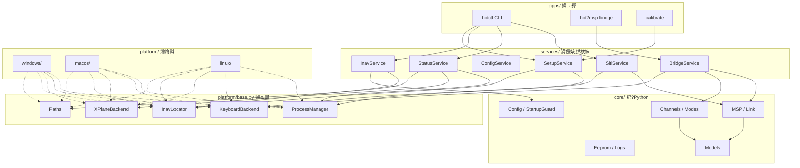
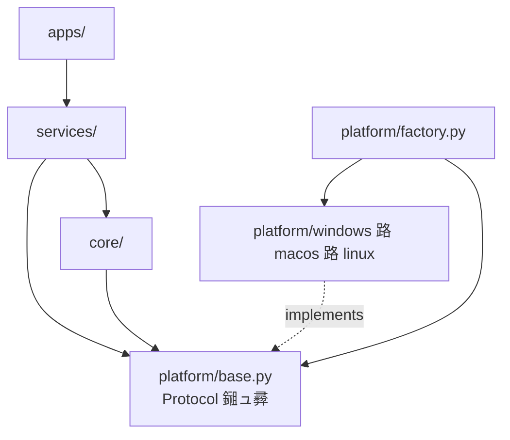
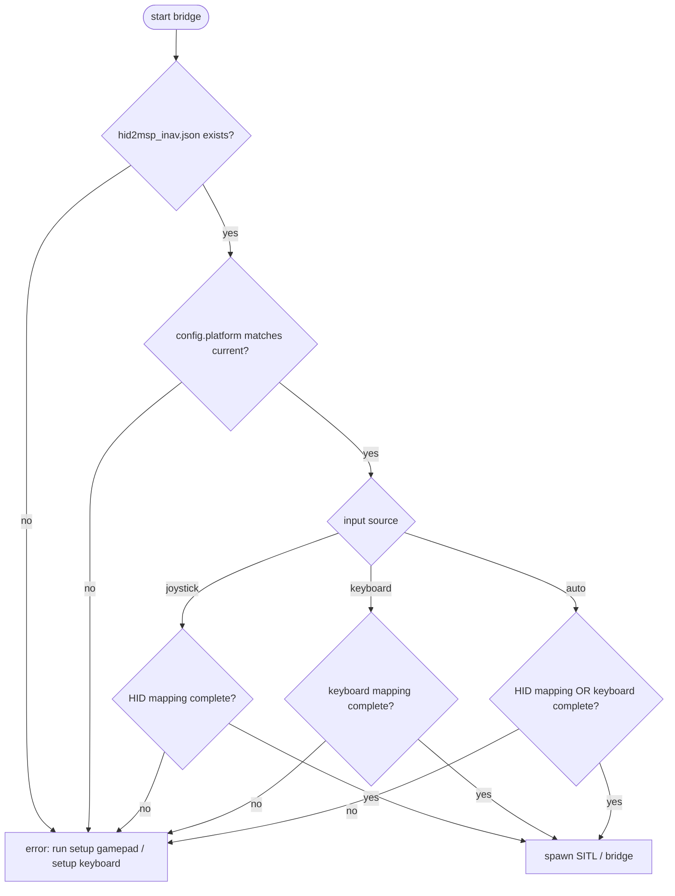
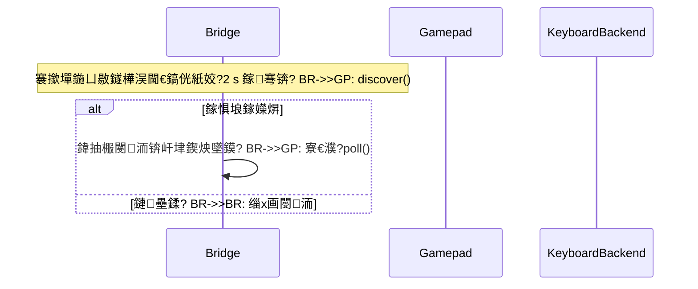
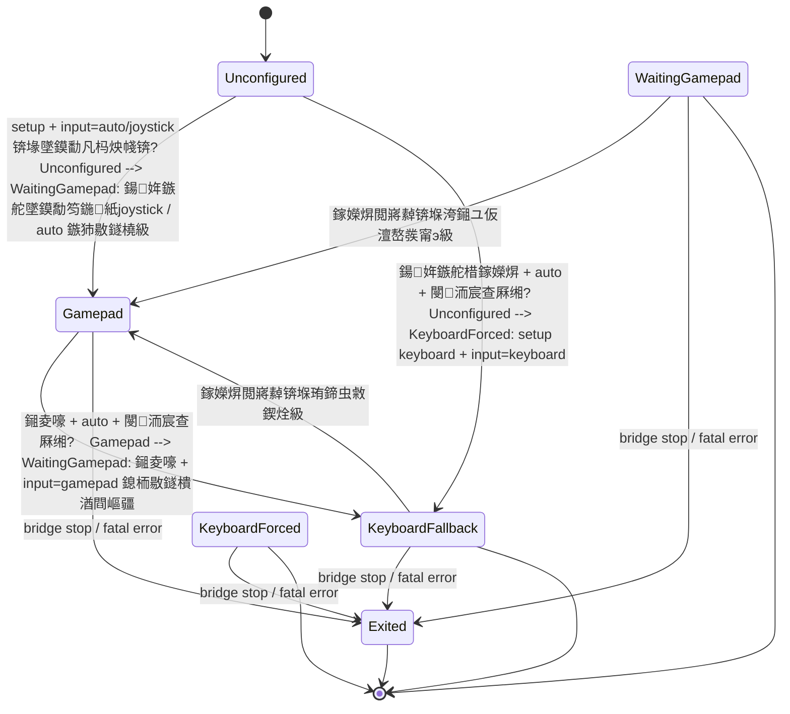
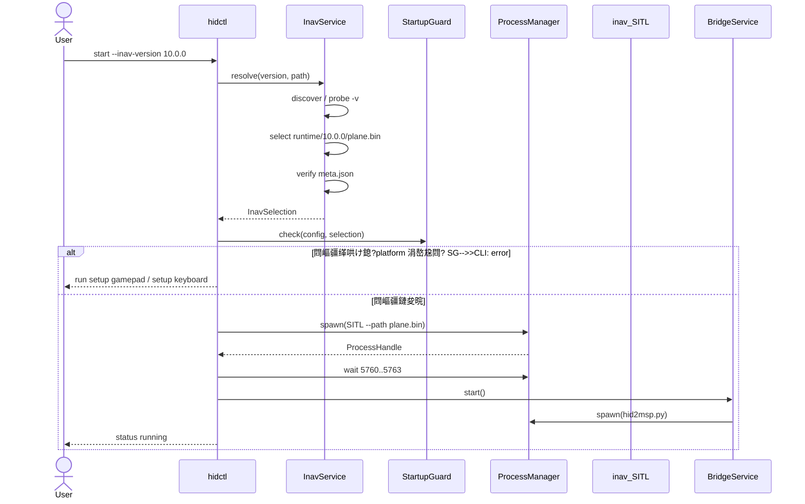
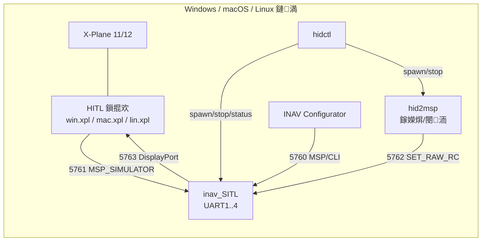

# 璺ㄥ钩鍙伴噸鏋勮鍒掍功

**鐩爣鍒嗘敮锛?* `cross-platform`  
**瑕嗙洊骞冲彴锛?* Windows 10/11銆乵acOS銆丩inux  
**鐘舵€侊細** 宸茶瘎瀹★紙寰呭疄鏂斤級  
**鍘熷垯锛?* 涓€濂楁牳蹇冧唬鐮?+ 涓変釜骞冲彴閫傞厤鍣紱涓嶅叡浜钩鍙板疄鐜般€?
---

## 1. 鑳屾櫙

褰撳墠浠撳簱鏈変袱涓嫭绔嬪疄鐜帮細

- `main`锛歮acOS 鍒嗘敮锛孋oreGraphics 閿洏銆乣lsof/pgrep/killpg` 杩涚▼绠＄悊銆乣.app` 鎺㈡祴锛?- `windows`锛歐indows 鍒嗘敮锛學in32 杩涚▼/閿洏/鍓嶅彴绐楀彛銆乣taskkill`銆佹敞鍐岃〃鎺㈡祴锛屽苟棰濆鍋氫簡
  setup 鍚戝銆丮SP probe/tap銆佹棩蹇楁椂闂存埑銆侀攣鎭㈠銆佹墜鏌勬帀绾垮洖閫€閿洏绛夈€?
涓や釜鍒嗘敮鐨?MSP銆侀€氶亾鏄犲皠銆侀厤缃牸寮忋€丆LI 鍔犺浇銆乪eprom 澶囦唤銆佹棩蹇椼€佹枃妗ｉ珮搴﹂噸澶嶃€?缁х画澶嶅埗浼氬甫鏉ワ細

- 鍚屼竴涓?bug 瑕佷慨涓ゆ锛?- 涓や釜鍒嗘敮琛屼负閫愭笎鍒嗗弶锛?- 澧炲姞 Linux 浼氬彉鎴愮涓変唤澶嶅埗锛?- INAV 鐗堟湰鍜?eeprom 瀹规槗娣风敤銆?
鏈鍒掓妸鈥滃彲鍏变韩鐨勯€昏緫鈥濆拰鈥滃繀椤绘寜骞冲彴瀹炵幇鐨勭郴缁熻皟鐢ㄢ€濇媶寮€锛屽舰鎴愪笁骞冲彴鍒嗘敮銆?
## 2. 鐩爣涓庨潪鐩爣

### 2.1 鐩爣

1. 涓€涓?`cross-platform` 鍒嗘敮鍚屾椂鏀寔 Windows銆乵acOS銆丩inux銆?2. `core/` 涓嶅嚭鐜?`sys.platform`銆乣os.name`銆乄in32銆丆oreGraphics銆乣lsof` 绛夊钩鍙板垽鏂€?3. 骞冲彴宸紓鍏ㄩ儴灏佽鍦?`platform/` 鐨勯€傞厤鍣ㄤ腑銆?4. CLI 鍛戒护銆侀厤缃牸寮忋€佺姸鎬佽緭鍑轰笁骞冲彴涓€鑷淬€?5. 鏀寔澶?INAV 鐗堟湰鍏卞瓨锛歚--inav-version` / `--inav-path` 鏄惧紡閫夋嫨銆?6. 姣忎釜 INAV 鐗堟湰浣跨敤鐙珛 eeprom 鍜?CLI 婧愰厤缃紝鐗堟湰涓嶅尮閰嶆椂鎷掔粷鍚姩銆?7. 涓嶆彁渚涗换浣曢粯璁ゆ墜鏌勬槧灏勬垨榛樿閿綅锛涢娆′娇鐢ㄥ繀椤昏繍琛?setup銆?8. 鎸夐敭閰嶇疆鏄?*鏈満鏍囧畾缁撴灉**锛屼笉鍋氳法骞冲彴杞崲銆佷笉淇濊瘉鍙嫹璐濄€?
### 2.2 闈炵洰鏍?
- 涓嶆妸 macOS 鐨勬寜閿厤缃嚜鍔ㄧ炕璇戞垚 Windows/Linux锛?- 涓嶆彁渚涒€滀竴浠介厤缃笁骞冲彴閫氱敤鈥濓紱
- 涓嶅悎骞?`main` 鍜?`windows` 鐨勫巻鍙蹭唬鐮侊紱
- 涓嶉噸鍐?INAV 鍥轰欢鎴?HITL 鎻掍欢锛?- 涓嶅湪鏈樁娈垫敮鎸?Wayland 涓嬬殑鍏ㄥ眬閿洏锛堣椋庨櫓锛夈€?
## 3. 鐜扮姸闂

| 闂 | 褰卞搷 |
|---|---|
| `hidctl.py` 涓や唤锛岃繘绋?绔彛/鎺㈡祴閫昏緫閲嶅 | 淇?bug 瑕佹敼涓ゅ |
| `keyboard_input.py` 涓や唤锛岄敭鍚?缁勫悎閿涔変笉鍚?| 閰嶇疆涓嶅彲姣旇緝锛岃涓哄垎鍙?|
| 鍗曚唤 `plane.bin`锛岃嚜鍔ㄩ€夆€滄渶楂樼増鏈€?SITL | INAV 9/10 eeprom 鍙兘娣风敤 |
| 鎵嬫焺/閿洏娌℃湁榛樿鏄犲皠鍚庯紝鍚姩妫€鏌ュ垎鏁?| 鍙兘鍚姩鍒颁竴鍗婃墠鎶ラ敊 |
| 骞冲彴鍒ゆ柇鏁ｈ惤鍦?CLI/鏈嶅姟閲?| 鏃犳硶鍔?Linux锛屾祴璇曞洶闅?|
| 涓や唤 README 鍐呭涓嶅悓姝?| 鐢ㄦ埛鎸夐敊鏂囨。鎿嶄綔 |

## 4. 璁捐鍘熷垯

1. **渚濊禆鍊掔疆**锛歝ore 瀹氫箟鎺ュ彛锛宲latform 瀹炵幇鎺ュ彛锛沜ore 涓?import platform銆?2. **缁勫悎鏍瑰敮涓€**锛氬彧鏈?`platform/factory.py` 鏍规嵁 `sys.platform` 閫夋嫨瀹炵幇銆?3. **鏄惧紡閰嶇疆**锛氭病鏈夐粯璁ゆ槧灏勶紱鍚姩鍓嶅己鍒舵鏌ワ紱閰嶇疆甯?`platform` 鏍囪瘑銆?4. **鎸夌増鏈殧绂?*锛歋ITL 浜岃繘鍒躲€乪eprom銆丆LI 婧愭枃浠躲€佽繍琛岀姸鎬侀兘鎸?INAV 鐗堟湰鍒嗙洰褰曘€?5. **澶辫触瑕佹棭**锛氬惎鍔ㄥ墠瀹屾垚妫€鏌ワ紝涓嶆妸閿欒鐣欏埌杩愯涓€?6. **骞冲彴鑳藉姏鏄惧紡鍖?*锛氫笉鏀寔鐨勮兘鍔涜繑鍥?`capabilities`锛宑ore 闄嶇骇鑰屼笉鏄亣瑁呮敮鎸併€?
## 5. 鐩爣鏋舵瀯

```text
apps/                  hidctl / hid2msp / calibrate
  鈹?services/              SITL銆乥ridge銆乻tatus銆乧onfig銆乻etup 缂栨帓
  鈹?core/                  绾?Python锛屾棤 OS 璋冪敤
  鈹溾攢 msp.py            MSP v1/v2 甯?  鈹溾攢 channels.py       杞?鎸夐敭 鈫?CH1鈥揅H16銆佹ā寮忚〃銆佹洸绾?  鈹溾攢 config.py         JSON schema銆佹牎楠?  鈹溾攢 link.py           TCP MSP 杩炴帴/閲嶈繛
  鈹溾攢 eeprom.py         澶囦唤/鎭㈠/閲嶇疆
  鈹溾攢 logpump.py        鏃堕棿鎴炽€侀€€鍑虹爜
  鈹溾攢 models.py         StatusModel銆両navInstall銆丳rocessHandle
  鈹溾攢 startup.py        鍚姩鍓嶆鏌?  鈹斺攢 setup_flow.py     鍚戝娴佺▼锛堜笉纰板叿浣撴寜閿?API锛?  鈹?platform/              鍙湁杩欓噷鑳借皟绯荤粺 API
  鈹溾攢 base.py           Protocol / dataclass
  鈹溾攢 factory.py        鍞竴鐨勫钩鍙板垎鏀?  鈹溾攢 windows/
  鈹溾攢 macos/
  鈹斺攢 linux/
```

### 5.1 鐩綍缁撴瀯

```text
src/hidrx/
  apps/
    hidctl.py
    hid2msp.py
    calibrate.py
  services/
    sitl.py
    bridge.py
    status.py
    config.py
    setup.py
    inav.py
  core/
    msp.py
    channels.py
    config.py
    link.py
    eeprom.py
    logpump.py
    models.py
    startup.py
    setup_flow.py
  platform/
    base.py
    factory.py
    windows/
      processes.py
      keyboard.py
      xplane.py
      inav_locator.py
      paths.py
    macos/
      ...
    linux/
      ...
config/
  hid2msp.example.json      绌烘ā鏉?  inav/
    10.0.0/minimal.txt
    8.0.1/minimal.txt
  runtime/                  鏈満鐘舵€侊紝蹇界暐
    inav.json
    10.0.0/plane.bin
    10.0.0/meta.json
tests/
  core/
  platform/
```

### 5.2 骞冲彴鎺ュ彛

```python
class ProcessManager(Protocol):
    def spawn(self, spec: ProcessSpec) -> ProcessHandle: ...
    def stop(self, handle: ProcessHandle) -> None: ...
    def is_alive(self, handle: ProcessHandle) -> bool: ...
    def find(self, name: str) -> list[ProcessHandle]: ...
    def port_listening(self, port: int) -> bool: ...

class KeyboardBackend(Protocol):
    platform: str
    backend: str

    def available(self) -> bool: ...
    def capabilities(self) -> KeyboardCapabilities: ...
    def foreground_matches(self, target: str) -> bool: ...
    def validate(self, binding: str) -> None: ...
    def is_down(self, binding: str) -> bool: ...
    def capture(self, timeout: float) -> str | None: ...

class XPlaneBackend(Protocol):
    def locate(self) -> XPlaneInfo | None: ...
    def running(self) -> ProcessInfo | None: ...
    def plugin(self, aircraft: str) -> PluginInfo | None: ...

class InavLocator(Protocol):
    def discover(self) -> list[InavInstall]: ...
    def resolve_path(self, path: Path) -> InavInstall | None: ...

class Paths(Protocol):
    repo_root: Path
    config_dir: Path
    runtime_dir: Path
    logs_dir: Path
    run_dir: Path
```

`ProcessHandle` 缁熶竴鍖呭惈 `pid + start_time + exe`锛屼笉鏆撮湶 `HANDLE`銆乣pidfd`銆?
#### 鎺ュ彛绫诲浘


### 5.3 缁勫悎鏍?
```python
def create_platform() -> Platform:
    if sys.platform == "win32":
        return WindowsPlatform()
    if sys.platform == "darwin":
        return MacOSPlatform()
    if sys.platform.startswith("linux"):
        return LinuxPlatform()
    raise RuntimeError(f"unsupported platform: {sys.platform}")
```

闄?`factory.py` 鍜?`platform/` 澶栵紝浠撳簱涓姝㈠嚭鐜板钩鍙板垽鏂€?
### 5.4 缁勪欢鍥句笌鍒嗗眰渚濊禆





渚濊禆鏂瑰悜鍙兘鍚戜笅锛沗core` 瀵?`platform` 鐨勫疄鐜伴浂渚濊禆銆?
## 6. 鎸夐敭閰嶇疆绛栫暐

### 6.1 涓嶅仛棰勮銆佷笉鍋氳法骞冲彴杞崲

- 娌℃湁榛樿鎵嬫焺杞存槧灏勶紱
- 娌℃湁榛樿閿綅锛?- 娌℃湁 `win 鈫?Command` 涔嬬被缈昏瘧锛?- 閰嶇疆鏄?*鏈満涓€娆℃€х殑鏍囧畾缁撴灉**銆?
### 6.2 閰嶇疆甯﹀钩鍙版爣璇?
```json
{
  "platform": "windows",
  "keyboard": {
    "backend": "win32",
    "keys": {
      "roll_left": "left",
      "arm": "ctrl+a"
    }
  },
  "axes": [],
  "buttons": []
}
```

鍚姩妫€鏌ワ細

```text
config.platform == current_platform
config.keyboard.backend == current_backend
```

涓嶅尮閰嶇洿鎺ユ嫆缁濓紝骞舵彁绀洪噸鏂拌繍琛?`setup keyboard`銆?
### 6.3 閿綅鐢卞钩鍙拌В閲?
core 鍙妸 `binding` 褰撳瓧绗︿覆閫忎紶锛?
```python
keyboard.is_down(config.keys["arm"])
```

- Windows 瑙ｉ噴 `ctrl+a`锛?- macOS 瑙ｉ噴鑷繁鐨勫師鐢熼敭鍚嶏紱
- Linux 瑙ｉ噴 X11 keysym锛?- core 涓嶈В鏋愩€佷笉杞崲銆?
### 6.4 寮哄埗 setup

`StartupGuard` 鍦ㄥ惎鍔?SITL/bridge 鍓嶆鏌ワ細

1. `config/hid2msp_inav.json` 瀛樺湪锛?2. `platform` / `backend` 鍖归厤锛?3. 瑙ｆ瀽杈撳叆婧愶紙`--input` 浼樺厛锛屽惁鍒欓厤缃?`keyboard.source`锛夛細
   - `gamepad`锛氳嚦灏戜竴濂?`axes`/`buttons`锛涙墜鏌勫綋鍓嶄笉鍦ㄤ篃鍙互鍚姩锛宐ridge 杩涘叆鈥滅瓑寰呮墜鏌勨€濓紱
   - `keyboard`锛歚KEYBOARD_ACTIONS` 鍏ㄩ儴鏈夌粦瀹氾紱
   - `auto`锛氭湁 `axes`/`buttons` 鎴栭敭鐩樺畬鏁村嵆鍙紱涓よ€呴兘娌℃湁鎵嶆姤閿欙紱
4. 涓嶆弧瓒?鈫?涓嶅惎鍔紝鎻愮ず锛?
```text
run: .\hidctl.cmd setup gamepad
run: .\hidctl.cmd setup keyboard
```

`--test` 鍚堟垚閫氶亾鍙互缁曡繃锛涙甯稿惎鍔ㄤ笉鍏佽绌洪厤缃€?
### 6.5 鍚姩闂ㄧ娴佺▼



### 6.6 杈撳叆婧愰€夋嫨銆佹帀绾垮洖閫€涓庨噸杩?
#### 6.6.1 鍚姩鏃舵墜鍔ㄩ€夋嫨杈撳叆婧?
```powershell
.\hidctl.cmd start bridge --input auto       # 榛樿锛氭墜鏌勪紭鍏堬紝鎺夌嚎鍥為€€閿洏锛岄噸杩炴敹鍥?.\hidctl.cmd start bridge --input gamepad   # 寮哄埗鎵嬫焺锛岀姝㈠洖閫€
.\hidctl.cmd start bridge --input keyboard   # 寮哄埗閿洏锛屽畬鍏ㄥ拷鐣ユ墜鏌?```

| 妯″紡 | 鎵嬫焺瀛樺湪 | 鎵嬫焺鎺夌嚎 | 鎵嬫焺閲嶈繛 |
|---|---|---|---|
| `auto` | 鐢ㄦ墜鏌?| 閿洏宸查厤缃?鈫?鍥為€€閿洏锛涘惁鍒?*鏆傚仠鍙?RC锛坆ridge 涓嶉€€鍑猴級** | 鑷姩鏀跺洖鎵嬫焺 |
| `gamepad` | 鐢ㄦ墜鏌?| **鏆傚仠鍙?RC锛宐ridge 淇濇寔杩愯**锛孲ITL 杩涘叆 failsafe | **绔嬪嵆鎭㈠鍙?RC** |
| `keyboard` | 蹇界暐 | 涓嶅彈褰卞搷 | 蹇界暐 |

`--input gamepad` 鐨勮涔夋槸鈥滄妸鎺夌嚎褰撴垚鎺ユ敹鏈哄け鎺р€濓細**涓嶄吉閫犱腑绔嬮€氶亾銆佷笉鍒囨崲閿洏銆佷笉缁х画鍙戝抚銆佽繘绋嬩篃涓嶉€€鍑?*锛岃 SITL 鑷繁瑙﹀彂 failsafe锛涙墜鏌勯噸鏂板嚭鐜板悗缁х画鍙戝抚锛岄仴鎺ф仮澶嶃€?`auto` 涓旈敭鐩樻湭閰嶇疆鏃跺悓鏍疯繘鍏モ€滄殏鍋滃彂甯с€佺瓑寰呮墜鏌勨€濈殑鐘舵€侊紝鑰屼笉鏄€€鍑恒€?`--input` 瑕嗙洊 `keyboard.source`锛涗笉浼犳椂鐢ㄩ厤缃噷鐨?`source`锛堥粯璁?`auto`锛夈€?
#### 6.6.2 鎺夌嚎鍥為€€鏃跺簭

```mermaid
sequenceDiagram
    participant BR as Bridge
    participant GP as Gamepad
    participant KB as KeyboardBackend
    participant LINK as MSP Link

    loop 50 Hz
        BR->>GP: poll()
        alt 姝ｅ父
            GP-->>BR: axes, buttons
            BR->>LINK: SET_RAW_RC
        else GamepadDisconnected
            GP-->>BR: exception
            alt input=auto 涓旈敭鐩橀厤缃畬鏁?                BR->>KB: create()
                BR->>KB: restore_channels(last_channels)
                BR->>BR: 杩涘叆閿洏鍥為€€鎬?                Note over BR,KB: 缁х画鍙?RC锛屼笉閫€鍑?            else input=gamepad 鎴栭敭鐩樻湭閰嶇疆
                BR-->>BR: 鍋滄鍙戝抚锛屼繚鎸佽繘绋?                Note over BR: 姣?2 s 鎵弿鎵嬫焺锛汼ITL 杩涘叆 failsafe
            end
        end
    end
```

#### 6.6.3 鎵嬫焺閲嶈繛

**绛夊緟鎬侊紙`input=gamepad` 鎴?`auto` 鏃犻敭鐩橈級**锛歜ridge 姣?2 绉掓壂鎻忔墜鏌勶紱涓€鏃︽壘鍒帮紝鐩存帴鎶?`gamepad` 璁惧洖杈撳叆婧愬苟鎭㈠鍙戝抚銆傚洜涓烘帀绾挎湡闂翠竴甯ч兘娌″彂锛屼笉瀛樺湪鈥滃垏鍥炶烦鍙樷€濓紝鏃犻渶瀹夊叏鏉′欢銆?
**閿洏鍥為€€鎬侊紙`auto` + 閿洏宸查厤缃級**锛氭瘡 2 绉掑皾璇曞彂鐜版墜鏌勶紱涓€鏃︽壘鍒板氨**绔嬪嵆鍒囧洖鎵嬫焺**锛?涓嶆鏌ユ补闂ㄣ€丄RM 鎴?CH8 妯″紡銆?


#### 6.6.4 杈撳叆婧愮姸鎬佹満



`Unconfigured` 鐘舵€佷笅 `StartupGuard` 鎷掔粷鍚姩锛屼笉浜х敓 SITL/bridge銆?
## 7. INAV 鐗堟湰绠＄悊

### 7.1 绠＄悊瀵硅薄

| 瀵硅薄 | 浣嶇疆 |
|---|---|
| SITL 浜岃繘鍒?| 鐢?`--inav-path` / 鑷姩鍙戠幇鍐冲畾 |
| eeprom | `config/runtime/<version>/plane.bin` |
| eeprom 鍏冩暟鎹?| `config/runtime/<version>/meta.json` |
| CLI 婧愰厤缃?| `config/inav/<version>/minimal.txt` |
| HITL 鎻掍欢 | 鐢?X-Plane 瀹夎鍐冲畾锛宒octor 妫€鏌ュ吋瀹规€?|

### 7.2 CLI

```powershell
.\hidctl.cmd inav list
.\hidctl.cmd inav use 10.0.0
.\hidctl.cmd inav check "D:\INAV\10.0.0"

.\hidctl.cmd start --inav-version 10.0.0
.\hidctl.cmd start --inav-path "C:\...\INAV-Configurator_Win64_10.0.0"
.\hidctl.cmd config load --inav-version 10.0.0
.\hidctl.cmd backup eeprom --inav-version 10.0.0 --name before-tune
```

鍒悕锛歚--inav`銆乣--sitl`銆?
### 7.3 閫夋嫨浼樺厛绾?
1. `--inav-path`
2. `--inav-version`
3. `HIDRX_INAV_PATH` / `HIDRX_INAV_VERSION`
4. `config/runtime/inav.json` 鐨?active 鐗堟湰
5. 鑷姩鍙戠幇锛氬彇鏈€楂樼増鏈?
`--inav-path` 鍙互鏄畨瑁呯洰褰曟垨鍙墽琛屾枃浠讹紱鐩綍浼氳嚜鍔ㄦ煡鎵撅細

```text
inav_SITL.exe
inav_SITL
Contents/Resources/sitl/*/inav_SITL
```


### 7.4 鐗堟湰涓嶅尮閰嶅鐞?
鍚姩鏃惰鍙?`meta.json`锛?
```json
{
  "inav_version": "10.0.0",
  "build": "86a0441c",
  "platform": "windows",
  "sha256": "..."
}
```

- 鐗堟湰涓嶄竴鑷?鈫?鎷掔粷鍚姩锛?- eeprom 缂哄け 鈫?鎻愮ず `config load`锛?- 涓嶅仛鑷姩杩佺Щ銆佷笉闈欓粯澶嶇敤鏃?eeprom銆?
### 7.5 骞冲彴鍙戠幇

| 骞冲彴 | 鑷姩鍙戠幇 |
|---|---|
| Windows | Configurator 瀹夎鐩綍銆佹敞鍐岃〃 Steam 璺緞銆乣HIDRX_INAV_PATH` |
| macOS | `/Applications/INAV Configurator*.app/Contents/Resources/sitl/macos/inav_SITL` |
| Linux | `~/.local/share/INAV Configurator/...`銆丄ppImage 瑙ｅ寘鐩綍銆乣/usr/bin/inav_SITL` |

### 7.6 鍚姩鏃跺簭



### 7.7 閮ㄧ讲鍥?


## 8. 鍒嗘敮涓庝粨搴撶瓥鐣?
- 鏂板垎鏀細`cross-platform`锛屼粠 `windows` 鍒涘缓锛圵indows 鍔熻兘鏈€鍏紝渚夸簬鎶芥牳蹇冿級锛?- `main` 鍜?`windows` 鍐荤粨涓哄弬鑰冨疄鐜帮紝涓嶅啀鍔犳柊鍔熻兘锛?- 涓嶆妸 `main`/`windows` 鐨勪唬鐮?merge 杩涙柊鍒嗘敮锛屽彧鎸夋ā鍧楅€夋嫨鎬ф惉杩侊紱
- 鏂囨。鍙繚鐣欎竴浠?`README.md`锛屾棫 macOS 鏂囨。绉诲埌 `docs/history/`锛?- 鐗堟湰绠＄悊浜х敓鐨?`config/runtime/` 鍏ㄩ儴蹇界暐銆?
## 9. 杩佺Щ闃舵

### Phase 0锛氬喕缁撲笌鐩樼偣锛? 澶╋級

- 鏍囪 `main`/`windows` 涓哄彧璇诲弬鑰冿紱
- 鍒楀嚭涓ゅ垎鏀姛鑳界煩闃碉紙杩涚▼銆侀敭鐩樸€佹帰娴嬨€侀厤缃€佹棩蹇椼€乻etup銆乪eprom锛夛紱
- 纭 Linux 閿洏绛栫暐锛歑11 瀹屾暣鏀寔锛學ayland 鍙檷绾с€?
**閫€鍑猴細** 鍔熻兘鐭╅樀璇勫閫氳繃銆?
### Phase 1锛氭娊鏍稿績锛? 澶╋級

- 浠?`windows` 鎶藉嚭 `msp.py`銆乣channels.py`銆乣config.py`銆乣eeprom.py`銆乣logpump.py`锛?- 鍘绘帀 core 鍐呮墍鏈夊钩鍙板垽鏂紱
- 涓?core 寤哄崟鍏冩祴璇曪紙MSP 甯с€侀€氶亾鏄犲皠銆侀厤缃牎楠岋級銆?
**閫€鍑猴細** core 娴嬭瘯涓嶄緷璧?OS锛屽叏閮ㄩ€氳繃銆?
### Phase 2锛氭帴鍙ｄ笌 Fake 閫傞厤鍣紙2 澶╋級

- 瀹氫箟 `platform/base.py`锛?- 瀹炵幇 `FakePlatform`锛堝唴瀛樿繘绋嬨€佽剼鏈寲閿洏銆佸亣 X-Plane锛夛紱
- 鏈嶅姟灞傜敤 Fake 璺戦€?start/stop/status/doctor銆?
**閫€鍑猴細** 鏃犵湡瀹?OS 璋冪敤涔熻兘璺戝畬鏁翠笟鍔℃祦銆?
### Phase 3锛歐indows 閫傞厤鍣紙3 澶╋級

- 鎼?Win32 杩涚▼銆侀敭鐩樸€佸墠鍙扮獥鍙ｃ€乆-Plane 鎺㈡祴锛?- 瀵归綈 PID+鍒涘缓鏃堕棿銆乣taskkill`銆丏ETACHED_PROCESS锛?- 杩佺Щ鐜版湁 Windows 閰嶇疆鍜?eeprom銆?
**閫€鍑猴細** Windows 鍔熻兘涓庡綋鍓?`windows` 鍒嗘敮涓€鑷淬€?
### Phase 4锛歮acOS 閫傞厤鍣紙4 澶╋級

- 鎼?CoreGraphics 閿洏銆両nput Monitoring 妫€鏌ワ紱
- `lsof/pgrep/killpg` 杩涚▼锛?- `.app`/`Info.plist` X-Plane 鎺㈡祴锛?- 杩佺Щ `main` 鍒嗘敮鍔熻兘銆?
**閫€鍑猴細** macOS 鍔熻兘涓?`main` 涓€鑷淬€?
### Phase 5锛歀inux 閫傞厤鍣紙6 澶╋級

- POSIX 杩涚▼銆乣/proc` 韬唤銆乣ss`/`/proc/net/tcp` 绔彛锛?- X11 閿洏/鍓嶅彴绐楀彛锛?- Steam/AppImage X-Plane 鍙戠幇锛?- Wayland 鑳藉姏闄嶇骇銆?
**閫€鍑猴細** X11 妗岄潰鍙畬鏁?start/stop/status/閿洏/鎵嬫焺銆?
### Phase 6锛欼NAV 鐗堟湰绠＄悊锛? 澶╋級

- `inav list/use/check`锛?- `--inav-version` / `--inav-path`锛?- 鎸夌増鏈?eeprom/CLI/`meta.json`锛?- 鐗堟湰涓嶅尮閰嶆嫆缁濆惎鍔ㄣ€?
**閫€鍑猴細** 10.0.0 鍜?8.0.1 鍙叡瀛樺垏鎹紝浜掍笉姹℃煋銆?
### Phase 7锛欳LI 涓庢枃妗ｇ粺涓€锛? 澶╋級

- 鍚堝苟涓ゅ CLI 鍛戒护锛?- 涓€浠?README锛堝畨瑁呫€侀厤缃€佹搷浣溿€佸畨鍏ㄣ€丗AQ锛夛紱
- 杩佺Щ鎸囧崡锛氭棫 `plane.bin`銆佹棫 JSON銆佹棫鐜鍙橀噺銆?
**閫€鍑猴細** 涓夊钩鍙版枃妗ｅ懡浠や竴鑷达紝鏃у懡浠ゆ湁鍏煎鍒悕銆?
### Phase 8锛氭祴璇曚笌 CI锛? 澶╋級

- GitHub Actions 鐭╅樀锛歸indows-latest銆乵acos-latest銆乽buntu-latest锛?- core 鍗曟祴 + 閫傞厤鍣?contract test + 鍚姩鍐掔儫锛?- Linux 鐢?Xvfb 璺?X11 閿洏/绐楀彛娴嬭瘯锛?- 鎵嬪伐娓呭崟锛氫笁骞冲彴鍚勮窇涓€娆＄湡瀹?SITL + X-Plane銆?
**閫€鍑猴細** 涓夊钩鍙?CI 缁匡紝鎵嬪伐娓呭崟閫氳繃銆?
### Phase 9锛氬垏鎹紙2 澶╋級

- `cross-platform` 浣滀负榛樿鍒嗘敮锛?- `main`/`windows` 鎵?tag 褰掓。锛?- 鍙戝竷杩佺Щ璇存槑銆?
**閫€鍑猴細** 鏂板垎鏀彲鐙珛浣跨敤锛屾棫鍒嗘敮涓嶅啀缁存姢銆?
## 10. 娴嬭瘯绛栫暐

| 灞?| 鍐呭 |
|---|---|
| core 鍗曟祴 | MSP 缂栬В鐮併€侀€氶亾鏄犲皠銆侀厤缃牎楠屻€佸惎鍔ㄦ鏌ャ€佺増鏈€夋嫨銆佽緭鍏ユ簮绛栫暐锛坅uto/joystick/keyboard锛?|
| 閫傞厤鍣?contract | spawn/stop/is_alive銆佺鍙ｃ€侀敭鐩?capture/is_down銆乆-Plane 瀹氫綅 |
| 闆嗘垚 | 姣忓钩鍙板惎鍔?SITL + bridge锛屾鏌?5760鈥?763 |
| 鍥炲綊 | `auto` 鎺夌嚎鍥為€€閿洏銆侀噸杩炵珛鍗虫敹鍥烇紱`gamepad` 鎺夌嚎鏆傚仠鍙戝抚锛坆ridge 涓嶉€€鍑猴級骞惰Е鍙?failsafe銆侀噸杩炴仮澶嶏紱`keyboard` 蹇界暐鎵嬫焺锛沞eprom 鐗堟湰涓嶅尮閰嶏紱閰嶇疆缂哄け锛涢攣鎭㈠ |
| 鎵嬪伐 | 鐪熷疄 X-Plane 杩炴帴銆丱SD銆佸叚娈垫ā寮忋€乫ailsafe |

CI 鐭╅樀锛?
```yaml
strategy:
  matrix:
    os: [windows-latest, macos-latest, ubuntu-latest]
```

Linux 闇€瑕?`xvfb-run` 鎵嶈兘娴?X11 閿洏/鍓嶅彴绐楀彛锛沇ayland 鍙祴闄嶇骇璺緞銆?
## 11. 鍏煎涓庤縼绉?
- 淇濈暀鍛戒护锛歚start/stop/restart/status/logs/backup/restore/reset/config/setup/doctor`锛?- `HIDCTL_SITL` **涓嶅啀鏀寔**锛氭娴嬪埌璇ュ彉閲忔椂鐩存帴鎶ラ敊锛屾彁绀烘敼鐢?`--inav-path` 鎴?  `HIDRX_INAV_PATH`锛?- 鏃?`config/runtime/plane.bin` 棣栨鍚姩鏃舵彁绀鸿縼绉诲埌 `runtime/<version>/plane.bin`锛?- 鏃?`hid2msp_inav.json` 濡傛灉娌℃湁 `platform` 瀛楁锛岃涓衡€滄湭閰嶇疆鈥濓紝瑕佹眰閲嶆柊 setup锛?- 涓嶈嚜鍔ㄧ炕璇戞棫閿綅銆佷笉鑷姩澶嶇敤鏃?eeprom銆?
## 12. 椋庨櫓涓庡绛?
| 椋庨櫓 | 瀵圭瓥 |
|---|---|
| Linux Wayland 鏃犲叏灞€閿洏/鍓嶅彴绐楀彛 | `KeyboardCapabilities` 杩斿洖涓嶆敮鎸侊紱鏂囨。鏄庣‘瑕佹眰 X11锛涢鐗堜笉鍋?evdev 鍚庣 |
| macOS Input Monitoring 鏈巿鏉?| `doctor` 缁欏嚭绯荤粺璁剧疆璺緞锛涢敭鐩樹笉鍙敤鏃舵槑纭姤閿?|
| Windows X-Plane 浠ョ鐞嗗憳杩愯锛屽墠鍙版煡璇㈠け璐?| 杩涚▼鍚嶅け璐ユ椂鍥為€€绐楀彛鏍囬锛涗粛澶辫触鍒欐彁绀?|
| 涓夊钩鍙拌繘绋嬭韩浠藉垽鏂笉涓€鑷?| 缁熶竴 `pid + start_time + exe`锛宑ontract test 瑕嗙洊 |
| pygame 杞村彿璺ㄥ钩鍙颁笉鍚?| 姣忎釜骞冲彴蹇呴』 `setup gamepad`锛屼笉鍋氭槧灏勮浆鎹?|
| INAV 鐗堟湰/鎻掍欢鍏煎 | `doctor` 鏄剧ず鐗堟湰鐭╅樀锛涗笉鍏煎鍙鍛婏紝涓嶉樆姝?|
| 鑼冨洿鑶ㄨ儉 | 鎸?Phase 閫€鍑烘爣鍑嗘帹杩涳紝Linux 棣栫増鍙繚璇?X11 |

## 13. 宸ヤ綔閲忎及绠?
| 闃舵 | 浜烘棩 |
|---|---:|
| Phase 0鈥? | 7 |
| Windows 閫傞厤 | 3 |
| macOS 閫傞厤 | 4 |
| Linux 閫傞厤 | 6 |
| INAV 鐗堟湰绠＄悊 | 3 |
| CLI/鏂囨。 | 3 |
| 娴嬭瘯/CI | 4 |
| 鍒囨崲/鏀跺熬 | 2 |
| **鍚堣** | **绾?32 浜烘棩** |

鍗曚汉绾?6鈥? 鍛紱涓や汉骞惰鍙帇鍒?4 鍛ㄥ乏鍙筹紙Linux 鍜?macOS 鍙苟琛岋級銆?
## 14. 楠屾敹鏍囧噯

- [ ] 涓夊钩鍙伴兘鑳界敤鍚屼竴濂楀懡浠ゅ惎鍔?鍋滄/鏌ョ湅鐘舵€侊紱
- [ ] `core/` 鍜?`services/` 涓病鏈変换浣曞钩鍙板垽鏂紱
- [ ] 娌℃湁榛樿鎵嬫焺/閿洏鏄犲皠锛岄娆″惎鍔ㄥ己鍒?setup锛?- [ ] 閰嶇疆甯?`platform`锛岃法骞冲彴鎷疯礉浼氳鎷掔粷锛?- [ ] `--inav-version` / `--inav-path` 鍙敤锛岀増鏈笌 eeprom 鍖归厤锛?- [ ] 涓夊钩鍙?CI 缁匡紱
- [ ] 涓€浠?README 瑕嗙洊涓夊钩鍙帮紱
- [ ] `main`/`windows` 褰掓。锛屾柊鍔熻兘鍙繘 `cross-platform`銆?
## 15. 宸茬‘璁ゅ喅绛?
| 闂 | 鍐崇瓥 |
|---|---|
| Linux 閿洏/鍓嶅彴鑼冨洿 | **X11 瀹屾暣鏀寔锛沇ayland 闄嶇骇**锛氳繑鍥炰笉鏀寔鐨勮兘鍔涳紝鎻愮ず鐢ㄦ埛鍒?X11锛屼笉鍋囪鏀寔 |
| 閰嶇疆/鐘舵€佺洰褰?| **浠撳簱鐩綍**锛歚config/`銆乣config/runtime/`銆乣logs/`銆乣run/` |
| 鍒嗘敮鍚?| **`cross-platform`** |
| Setup 鍏ュ彛 | **淇濈暀涓や釜鐙珛鍚戝**锛歚setup gamepad`銆乣setup keyboard` |
| `HIDCTL_SITL` 鍏煎 | **绉婚櫎**锛氫笉鍐嶈鍙栵紱妫€娴嬪埌鏃舵姤閿欏苟鎻愮ず `--inav-path` / `HIDRX_INAV_PATH` |

杩欎簺鍐崇瓥宸茬粡鍐欏叆浠ヤ笂璁捐锛涗笉鍐嶄繚鐣欌€滃緟鍐崇瓥鈥濋」銆?
---

**闄勶細鍛戒护绀轰緥**

```powershell
# 棣栨瀹夎
.\hidctl.cmd setup gamepad
.\hidctl.cmd setup keyboard

# 閫夋嫨 INAV 鐗堟湰
.\hidctl.cmd inav list
.\hidctl.cmd start --inav-version 10.0.0

# 鎴栫洿鎺ユ寚瀹氬畨瑁呰矾寰?.\hidctl.cmd start --inav-path "C:\Program Files (x86)\INAV-Configurator_Win64_10.0.0"

# 鐘舵€?.\hidctl.cmd status
.\hidctl.cmd doctor

# eeprom
.\hidctl.cmd backup eeprom --inav-version 10.0.0 --name before-tune
.\hidctl.cmd config load --inav-version 10.0.0
```

---

## 16. 瀹炴柦杩涘害

- **Phase 0锛氬畬鎴?* 鈥?`cross-platform` 鍒嗘敮宸插垱寤恒€?- **Phase 1锛氬畬鎴?* 鈥?`src/hidrx/core/` 宸叉娊鍑?MSP銆侀€氶亾鏄犲皠銆侀厤缃€佸惎鍔ㄩ棬绂侊紱褰撳墠 84 涓?unittest锛圵indows 鏈湴 4 涓?POSIX 鐢ㄤ緥璺宠繃锛夈€?- **Phase 2锛氬畬鎴愶紙楠ㄦ灦锛?* 鈥?`platform/base.py` 鎺ュ彛銆乣platform/fake.py` 鍐呭瓨瀹炵幇銆乣tests/test_fake_platform.py` 宸插氨浣嶃€?- **Phase 3锛氬畬鎴?* 鈥?Windows `paths.py`銆乣processes.py`銆乣keyboard.py`銆乣xplane.py`銆乣inav_locator.py`銆乣platform.py` 涓?`platform/factory.py` 宸插畬鎴愶紱閿洏銆乆-Plane銆両NAV 瀹氫綅鍧囧凡鎺ュ叆銆?- **Phase 4锛氬畬鎴愶紙浠ｇ爜锛?* 鈥?macOS `paths.py`銆乣keyboard.py`锛坥sascript 鍓嶅彴闂ㄧ锛夈€乣xplane.py`銆乣inav_locator.py`銆乣platform.py` 涓庡叡浜?`posix/processes.py` 宸插畬鎴愶紱鏈湪鐪熷疄 macOS 鍐掔儫銆?- **Phase 5锛氬畬鎴愶紙浠ｇ爜锛?* 鈥?Linux `paths.py`銆乣keyboard.py`锛圶11 + Wayland 闄嶇骇锛夈€乣xplane.py`銆乣inav_locator.py`銆乣platform.py` 宸插畬鎴愶紱鏈湪鐪熷疄 X11 妗岄潰鍐掔儫銆?- **Bridge 杩愯鏃讹細瀹屾垚锛堜唬鐮侊級** 鈥?`core/keyboard.py`銆乣core/bridge.py`銆乣apps/bridge.py` 宸插疄鐜版墜鏌?閿洏鍥為€€銆佹帀绾挎殏鍋滃彂甯т笉閫€鍑恒€侀噸杩炴敹鍥烇紱`BridgeService` 鏀逛负鍚姩 `python -m hidrx.apps.bridge`銆?- **MSP 缃戠粶鍐掔儫锛氬畬鎴?* 鈥?`tests/test_bridge_network.py` 鐢ㄧ湡瀹?TCP socket 楠岃瘉 `SET_RAW_RC` 甯э紙鍛戒护 200銆?6 閫氶亾銆丆H1=2000锛夈€?- **閲嶅鍚姩淇濇姢锛氬畬鎴愶紙浠ｇ爜锛?* 鈥?CLI 鍚姩鍓嶆鏌?SITL/bridge 宸茶繍琛岋紱`SitlService` 鍙戠幇 5760鈥?763 浠讳竴绔彛宸插崰鐢ㄦ椂鎷掔粷鍐嶅惎鍔紱绔彛绛夊緟澶辫触鏃惰嚜鍔ㄥ仠鎺夊垰鍚姩鐨勫瓙杩涚▼銆?- **鍚姩闂ㄧ锛氬畬鎴愶紙浠ｇ爜锛?* 鈥?`require_ready` 鐜板湪杩樹細鐢ㄥ钩鍙?`KeyboardBackend.validate()` 鏍￠獙姣忎釜缁戝畾鐨勯敭鍚嶏紝闈炴硶閿湪鍚姩鍓嶅け璐ャ€?- **Status锛氬畬鎴愶紙浠ｇ爜锛?* 鈥?`services/status.py` 姹囨€荤粍浠?INAV/config/绔彛/X-Plane锛汣LI `status` 宸叉敼鐢ㄨ鏈嶅姟銆?- **Doctor锛氬畬鎴愶紙浠ｇ爜锛?* 鈥?`services/doctor.py` 妫€鏌ュ钩鍙般€侀敭鐩樿兘鍔涖€乆-Plane銆丠ITL 鎻掍欢銆両NAV 瀹夎/閫夋嫨/eeprom銆侀厤缃笌鍚姩闂ㄧ锛汣LI `doctor` 鐢?OK/WARN/FAIL 杈撳嚭骞跺湪澶辫触鏃惰繑鍥?1銆?- **Eeprom锛氬畬鎴愶紙浠ｇ爜锛?* 鈥?`services/eeprom.py` 鎸夌増鏈浠?鍒楄〃/鎭㈠/閲嶇疆锛汣LI `backup eeprom`銆乣backups`銆乣restore eeprom`銆乣reset --yes`銆?- **閰嶇疆婧愯縼绉伙細瀹屾垚** 鈥?鏃?`config/INAV_SITL_MINIMAL_NODEFAULTS.txt` 宸茶縼绉诲埌 `config/inav/10.0.0/minimal.txt`锛沗config/README.md` 鍜岀┖妯℃澘宸叉洿鏂颁负鎸夌増鏈?鏃犻粯璁ゆ槧灏勩€?- **CLI 閰嶇疆鍔犺浇锛氬畬鎴愶紙浠ｇ爜锛?* 鈥?`services/cli.py` 閫氳繃 5760 杩涘叆 CLI銆侀€愭潯鍙戦€併€佸彲閫?`save`锛汣LI `config load` 鏀寔 `--file/--port/--no-save/--inav-version/--inav-path`銆?- **Phase 6锛氶儴鍒嗗畬鎴?* 鈥?`services/inav.py` 鏀寔 `--inav-path` / `--inav-version` / 鐜鍙橀噺 / active / 鑷姩鏈€楂樼増鏈紝鎸夌増鏈殧绂?eeprom/meta/CLI 閰嶇疆锛岀増鏈笉鍖归厤鎷掔粷銆?- **Phase 7锛氶儴鍒嗗畬鎴?* 鈥?`apps/cli.py` 宸叉彁渚?`inav list/use/check`銆乣config check/load`銆乣setup keyboard/joystick`銆乣start/stop/restart/logs/status/doctor`銆乣backup/backups/restore/reset`銆乣--input` 涓庣増鏈弬鏁般€?- **鏂囨。锛氬畬鎴愶紙鍒濈锛?* 鈥?鏍?`README.md` 宸叉敼涓轰笁骞冲彴鐢ㄦ硶锛屽寘鍚娆?setup銆両NAV 鐗堟湰銆佽緭鍏ユā寮忋€乪eprom銆乨octor銆佹棫 `hidctl` 杩佺Щ琛ㄥ拰褰撳墠闄愬埗銆?- **鏃у疄鐜版竻鐞嗭細瀹屾垚** 鈥?`hidctl.py`銆乣hidctl.cmd`銆佹暣涓?`scripts/`銆佹棫 macOS 鏂囨。/绀烘剰鍥撅紙`docs/README-macos.md`銆乣docs/SOLUTION.md`銆乣docs/README.md`銆乣docs/*.png`銆乣docs/make_diagrams.py`锛夊凡鍒犻櫎锛涘彧淇濈暀 `docs/cross-platform-refactor-plan.md`銆?- **Phase 8锛氬畬鎴愶紙棣栬疆锛?* 鈥?`.github/workflows/cross-platform.yml` 鍦?GitHub Actions 涓?run 13 鐨?Windows/macOS/Ubuntu 涓変釜 job 鍏ㄩ儴 success锛沵acOS/Linux job 瀹為檯鎵ц浜?POSIX 杩涚▼ contract test銆?- **Phase 4+锛氳繘琛屼腑** 鈥?鏂?bridge 杩愯鏃跺凡鎺ュ叆锛涘畬鏁?CLI 鍏煎銆佺湡瀹炰笁骞冲彴浜や簰楠岃瘉寰呭仛銆?
