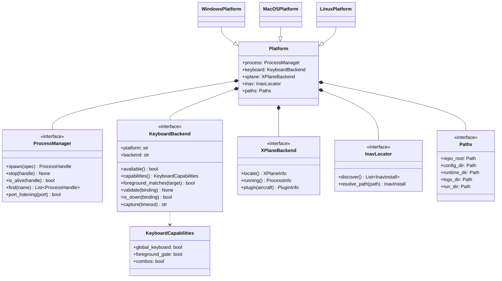
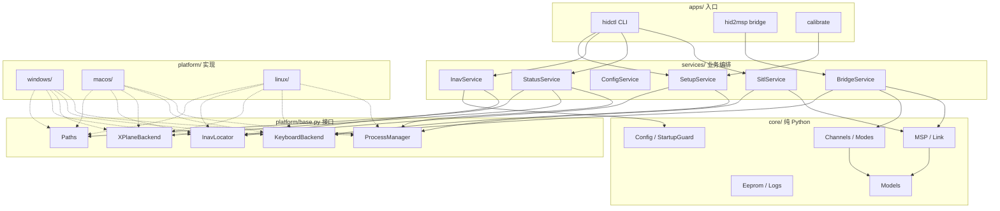
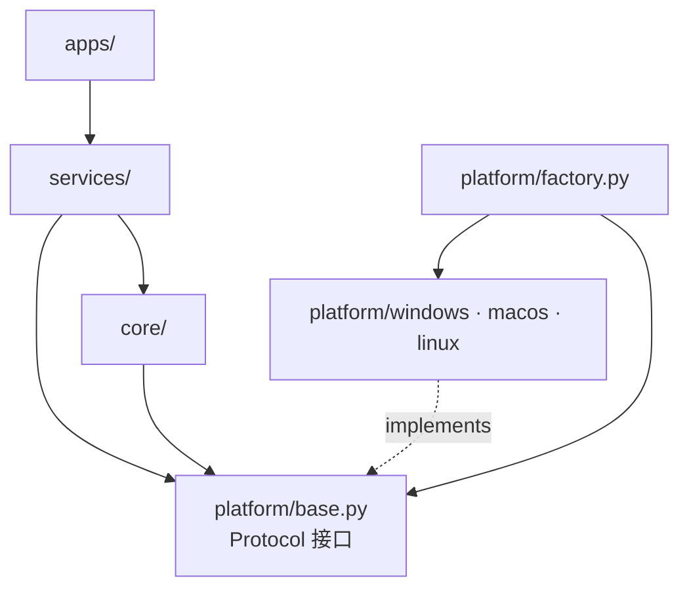
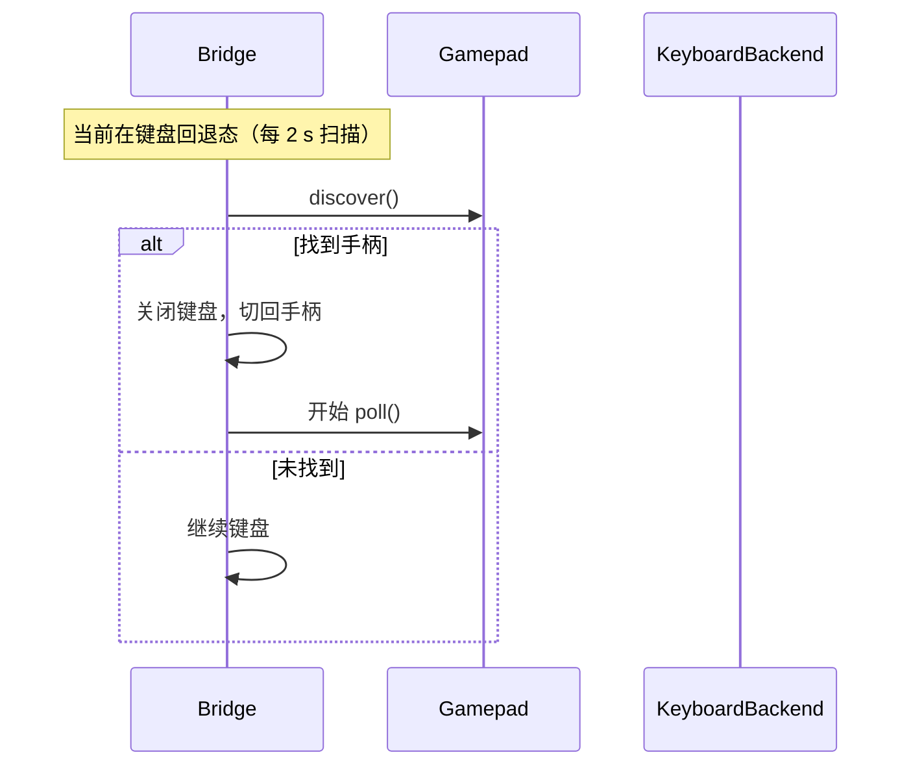
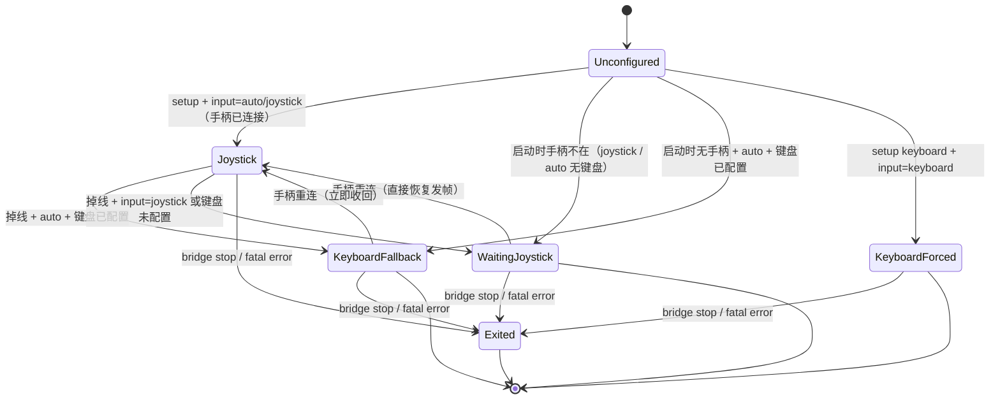
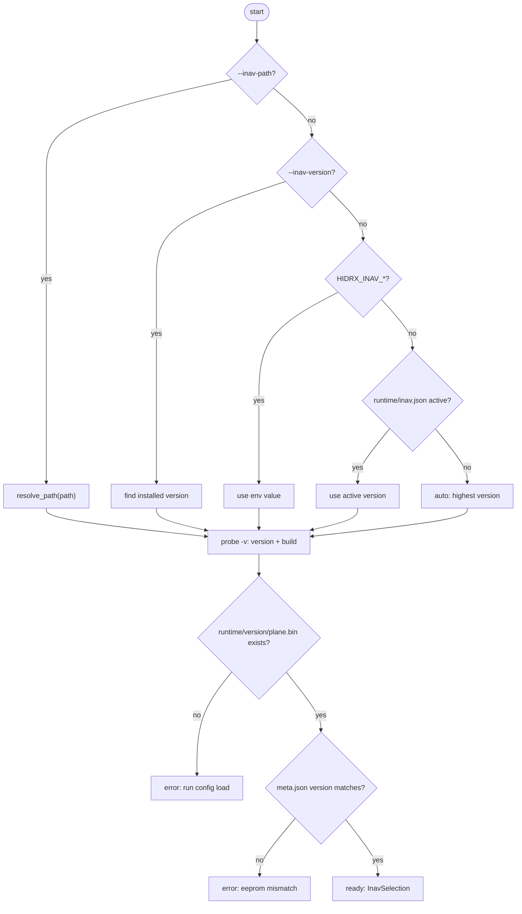
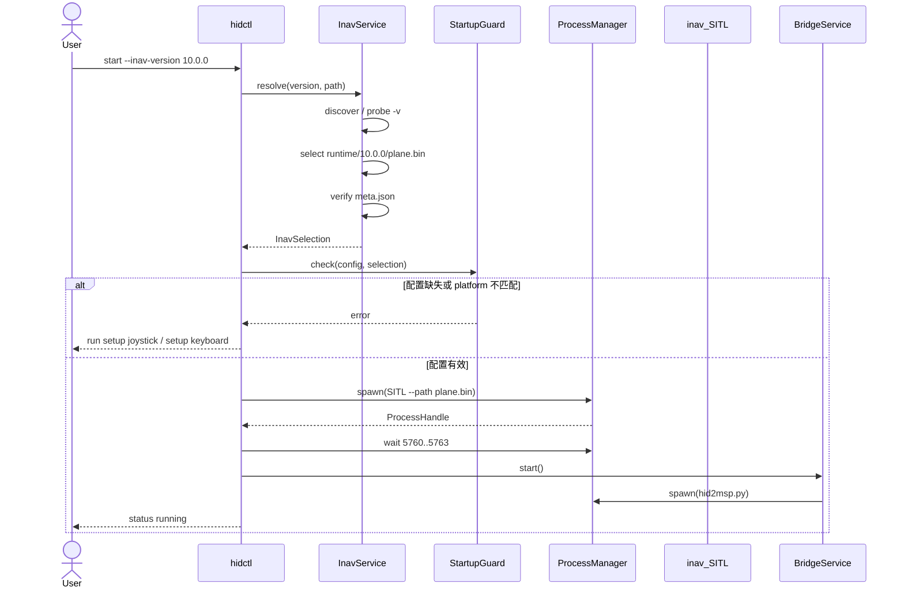
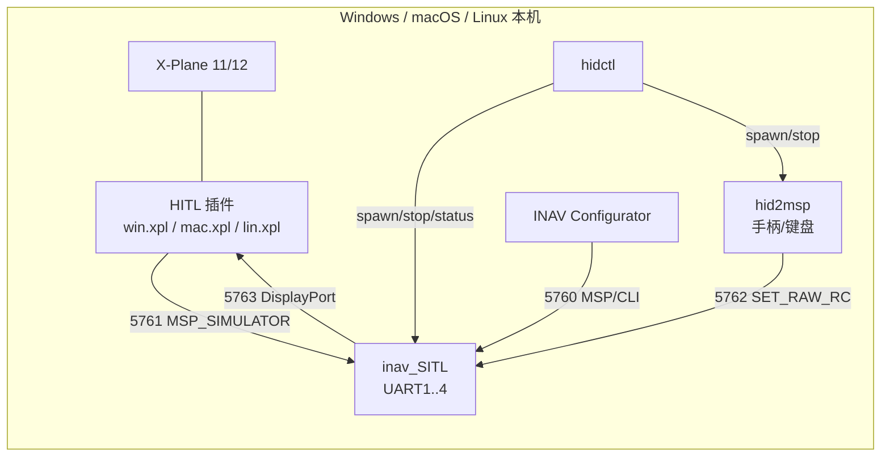

# 跨平台重构计划书

**目标分支：** `cross-platform`  
**覆盖平台：** Windows 10/11、macOS、Linux  
**状态：** 已评审（待实施）  
**原则：** 一套核心代码 + 三个平台适配器；不共享平台实现。

---

## 1. 背景

当前仓库有两个独立实现：

- `main`：macOS 分支，CoreGraphics 键盘、`lsof/pgrep/killpg` 进程管理、`.app` 探测；
- `windows`：Windows 分支，Win32 进程/键盘/前台窗口、`taskkill`、注册表探测，并额外做了
  setup 向导、MSP probe/tap、日志时间戳、锁恢复、手柄掉线回退键盘等。

两个分支的 MSP、通道映射、配置格式、CLI 加载、eeprom 备份、日志、文档高度重复。
继续复制会带来：

- 同一个 bug 要修两次；
- 两个分支行为逐渐分叉；
- 增加 Linux 会变成第三份复制；
- INAV 版本和 eeprom 容易混用。

本计划把“可共享的逻辑”和“必须按平台实现的系统调用”拆开，形成三平台分支。

## 2. 目标与非目标

### 2.1 目标

1. 一个 `cross-platform` 分支同时支持 Windows、macOS、Linux。
2. `core/` 不出现 `sys.platform`、`os.name`、Win32、CoreGraphics、`lsof` 等平台判断。
3. 平台差异全部封装在 `platform/` 的适配器中。
4. CLI 命令、配置格式、状态输出三平台一致。
5. 支持多 INAV 版本共存：`--inav-version` / `--inav-path` 显式选择。
6. 每个 INAV 版本使用独立 eeprom 和 CLI 源配置，版本不匹配时拒绝启动。
7. 不提供任何默认手柄映射或默认键位；首次使用必须运行 setup。
8. 按键配置是**本机标定结果**，不做跨平台转换、不保证可拷贝。

### 2.2 非目标

- 不把 macOS 的按键配置自动翻译成 Windows/Linux；
- 不提供“一份配置三平台通用”；
- 不合并 `main` 和 `windows` 的历史代码；
- 不重写 INAV 固件或 HITL 插件；
- 不在本阶段支持 Wayland 下的全局键盘（见风险）。

## 3. 现状问题

| 问题 | 影响 |
|---|---|
| `hidctl.py` 两份，进程/端口/探测逻辑重复 | 修 bug 要改两处 |
| `keyboard_input.py` 两份，键名/组合键语义不同 | 配置不可比较，行为分叉 |
| 单份 `plane.bin`，自动选“最高版本” SITL | INAV 9/10 eeprom 可能混用 |
| 手柄/键盘没有默认映射后，启动检查分散 | 可能启动到一半才报错 |
| 平台判断散落在 CLI/服务里 | 无法加 Linux，测试困难 |
| 两份 README 内容不同步 | 用户按错文档操作 |

## 4. 设计原则

1. **依赖倒置**：core 定义接口，platform 实现接口；core 不 import platform。
2. **组合根唯一**：只有 `platform/factory.py` 根据 `sys.platform` 选择实现。
3. **显式配置**：没有默认映射；启动前强制检查；配置带 `platform` 标识。
4. **按版本隔离**：SITL 二进制、eeprom、CLI 源文件、运行状态都按 INAV 版本分目录。
5. **失败要早**：启动前完成检查，不把错误留到运行中。
6. **平台能力显式化**：不支持的能力返回 `capabilities`，core 降级而不是假装支持。

## 5. 目标架构

```text
apps/                  hidctl / hid2msp / calibrate
  │
services/              SITL、bridge、status、config、setup 编排
  │
core/                  纯 Python，无 OS 调用
  ├─ msp.py            MSP v1/v2 帧
  ├─ channels.py       轴/按键 → CH1–CH16、模式表、曲线
  ├─ config.py         JSON schema、校验
  ├─ link.py           TCP MSP 连接/重连
  ├─ eeprom.py         备份/恢复/重置
  ├─ logpump.py        时间戳、退出码
  ├─ models.py         StatusModel、InavInstall、ProcessHandle
  ├─ startup.py        启动前检查
  └─ setup_flow.py     向导流程（不碰具体按键 API）
  │
platform/              只有这里能调系统 API
  ├─ base.py           Protocol / dataclass
  ├─ factory.py        唯一的平台分支
  ├─ windows/
  ├─ macos/
  └─ linux/
```

### 5.1 目录结构

```text
src/hidrx/
  apps/
    hidctl.py
    hid2msp.py
    calibrate.py
  services/
    sitl.py
    bridge.py
    status.py
    config.py
    setup.py
    inav.py
  core/
    msp.py
    channels.py
    config.py
    link.py
    eeprom.py
    logpump.py
    models.py
    startup.py
    setup_flow.py
  platform/
    base.py
    factory.py
    windows/
      processes.py
      keyboard.py
      xplane.py
      inav_locator.py
      paths.py
    macos/
      ...
    linux/
      ...
config/
  hid2msp.example.json      空模板
  inav/
    10.0.0/minimal.txt
    8.0.1/minimal.txt
  runtime/                  本机状态，忽略
    inav.json
    10.0.0/plane.bin
    10.0.0/meta.json
tests/
  core/
  platform/
```

### 5.2 平台接口

```python
class ProcessManager(Protocol):
    def spawn(self, spec: ProcessSpec) -> ProcessHandle: ...
    def stop(self, handle: ProcessHandle) -> None: ...
    def is_alive(self, handle: ProcessHandle) -> bool: ...
    def find(self, name: str) -> list[ProcessHandle]: ...
    def port_listening(self, port: int) -> bool: ...

class KeyboardBackend(Protocol):
    platform: str
    backend: str

    def available(self) -> bool: ...
    def capabilities(self) -> KeyboardCapabilities: ...
    def foreground_matches(self, target: str) -> bool: ...
    def validate(self, binding: str) -> None: ...
    def is_down(self, binding: str) -> bool: ...
    def capture(self, timeout: float) -> str | None: ...

class XPlaneBackend(Protocol):
    def locate(self) -> XPlaneInfo | None: ...
    def running(self) -> ProcessInfo | None: ...
    def plugin(self, aircraft: str) -> PluginInfo | None: ...

class InavLocator(Protocol):
    def discover(self) -> list[InavInstall]: ...
    def resolve_path(self, path: Path) -> InavInstall | None: ...

class Paths(Protocol):
    repo_root: Path
    config_dir: Path
    runtime_dir: Path
    logs_dir: Path
    run_dir: Path
```

`ProcessHandle` 统一包含 `pid + start_time + exe`，不暴露 `HANDLE`、`pidfd`。

#### 接口类图



### 5.3 组合根

```python
def create_platform() -> Platform:
    if sys.platform == "win32":
        return WindowsPlatform()
    if sys.platform == "darwin":
        return MacOSPlatform()
    if sys.platform.startswith("linux"):
        return LinuxPlatform()
    raise RuntimeError(f"unsupported platform: {sys.platform}")
```

除 `factory.py` 和 `platform/` 外，仓库中禁止出现平台判断。

### 5.4 组件图与分层依赖





依赖方向只能向下；`core` 对 `platform` 的实现零依赖。

## 6. 按键配置策略

### 6.1 不做预设、不做跨平台转换

- 没有默认手柄轴映射；
- 没有默认键位；
- 没有 `win → Command` 之类翻译；
- 配置是**本机一次性的标定结果**。

### 6.2 配置带平台标识

```json
{
  "platform": "windows",
  "keyboard": {
    "backend": "win32",
    "keys": {
      "roll_left": "left",
      "arm": "ctrl+a"
    }
  },
  "axes": [],
  "buttons": []
}
```

启动检查：

```text
config.platform == current_platform
config.keyboard.backend == current_backend
```

不匹配直接拒绝，并提示重新运行 `setup keyboard`。

### 6.3 键位由平台解释

core 只把 `binding` 当字符串透传：

```python
keyboard.is_down(config.keys["arm"])
```

- Windows 解释 `ctrl+a`；
- macOS 解释自己的原生键名；
- Linux 解释 X11 keysym；
- core 不解析、不转换。

### 6.4 强制 setup

`StartupGuard` 在启动 SITL/bridge 前检查：

1. `config/hid2msp_inav.json` 存在；
2. `platform` / `backend` 匹配；
3. 解析输入源（`--input` 优先，否则配置 `keyboard.source`）：
   - `joystick`：至少一套 `axes`/`buttons`；手柄当前不在也可以启动，bridge 进入“等待手柄”；
   - `keyboard`：`KEYBOARD_ACTIONS` 全部有绑定；
   - `auto`：有 `axes`/`buttons` 或键盘完整即可；两者都没有才报错；
4. 不满足 → 不启动，提示：

```text
run: .\hidctl.cmd setup joystick
run: .\hidctl.cmd setup keyboard
```

`--test` 合成通道可以绕过；正常启动不允许空配置。

### 6.5 启动门禁流程


### 6.6 输入源选择、掉线回退与重连

#### 6.6.1 启动时手动选择输入源

```powershell
.\hidctl.cmd start bridge --input auto       # 默认：手柄优先，掉线回退键盘，重连收回
.\hidctl.cmd start bridge --input joystick   # 强制手柄，禁止回退
.\hidctl.cmd start bridge --input keyboard   # 强制键盘，完全忽略手柄
```

| 模式 | 手柄存在 | 手柄掉线 | 手柄重连 |
|---|---|---|---|
| `auto` | 用手柄 | 键盘已配置 → 回退键盘；否则**暂停发 RC（bridge 不退出）** | 自动收回手柄 |
| `joystick` | 用手柄 | **暂停发 RC，bridge 保持运行**，SITL 进入 failsafe | **立即恢复发 RC** |
| `keyboard` | 忽略 | 不受影响 | 忽略 |

`--input joystick` 的语义是“把掉线当成接收机失控”：**不伪造中立通道、不切换键盘、不继续发帧、进程也不退出**，让 SITL 自己触发 failsafe；手柄重新出现后继续发帧，遥控恢复。
`auto` 且键盘未配置时同样进入“暂停发帧、等待手柄”的状态，而不是退出。
`--input` 覆盖 `keyboard.source`；不传时用配置里的 `source`（默认 `auto`）。

#### 6.6.2 掉线回退时序

```mermaid
sequenceDiagram
    participant BR as Bridge
    participant GP as Gamepad
    participant KB as KeyboardBackend
    participant LINK as MSP Link

    loop 50 Hz
        BR->>GP: poll()
        alt 正常
            GP-->>BR: axes, buttons
            BR->>LINK: SET_RAW_RC
        else GamepadDisconnected
            GP-->>BR: exception
            alt input=auto 且键盘配置完整
                BR->>KB: create()
                BR->>KB: restore_channels(last_channels)
                BR->>BR: 进入键盘回退态
                Note over BR,KB: 继续发 RC，不退出
            else input=joystick 或键盘未配置
                BR-->>BR: 停止发帧，保持进程
                Note over BR: 每 2 s 扫描手柄；SITL 进入 failsafe
            end
        end
    end
```

#### 6.6.3 手柄重连

**等待态（`input=joystick` 或 `auto` 无键盘）**：bridge 每 2 秒扫描手柄；一旦找到，直接把
`gamepad` 设回输入源并恢复发帧。因为掉线期间一帧都没发，不存在“切回跳变”，无需安全条件。

**键盘回退态（`auto` + 键盘已配置）**：每 2 秒尝试发现手柄；一旦找到就**立即切回手柄**，
不检查油门、ARM 或 CH8 模式。



#### 6.6.4 输入源状态机



`Unconfigured` 状态下 `StartupGuard` 拒绝启动，不产生 SITL/bridge。

## 7. INAV 版本管理

### 7.1 管理对象

| 对象 | 位置 |
|---|---|
| SITL 二进制 | 由 `--inav-path` / 自动发现决定 |
| eeprom | `config/runtime/<version>/plane.bin` |
| eeprom 元数据 | `config/runtime/<version>/meta.json` |
| CLI 源配置 | `config/inav/<version>/minimal.txt` |
| HITL 插件 | 由 X-Plane 安装决定，doctor 检查兼容性 |

### 7.2 CLI

```powershell
.\hidctl.cmd inav list
.\hidctl.cmd inav use 10.0.0
.\hidctl.cmd inav check "D:\INAV\10.0.0"

.\hidctl.cmd start --inav-version 10.0.0
.\hidctl.cmd start --inav-path "C:\...\INAV-Configurator_Win64_10.0.0"
.\hidctl.cmd config load --inav-version 10.0.0
.\hidctl.cmd backup eeprom --inav-version 10.0.0 --name before-tune
```

别名：`--inav`、`--sitl`。

### 7.3 选择优先级

1. `--inav-path`
2. `--inav-version`
3. `HIDRX_INAV_PATH` / `HIDRX_INAV_VERSION`
4. `config/runtime/inav.json` 的 active 版本
5. 自动发现：取最高版本

`--inav-path` 可以是安装目录或可执行文件；目录会自动查找：

```text
inav_SITL.exe
inav_SITL
Contents/Resources/sitl/*/inav_SITL
```



### 7.4 版本不匹配处理

启动时读取 `meta.json`：

```json
{
  "inav_version": "10.0.0",
  "build": "86a0441c",
  "platform": "windows",
  "sha256": "..."
}
```

- 版本不一致 → 拒绝启动；
- eeprom 缺失 → 提示 `config load`；
- 不做自动迁移、不静默复用旧 eeprom。

### 7.5 平台发现

| 平台 | 自动发现 |
|---|---|
| Windows | Configurator 安装目录、注册表 Steam 路径、`HIDRX_INAV_PATH` |
| macOS | `/Applications/INAV Configurator*.app/Contents/Resources/sitl/macos/inav_SITL` |
| Linux | `~/.local/share/INAV Configurator/...`、AppImage 解包目录、`/usr/bin/inav_SITL` |

### 7.6 启动时序



### 7.7 部署图



## 8. 分支与仓库策略

- 新分支：`cross-platform`，从 `windows` 创建（Windows 功能最全，便于抽核心）；
- `main` 和 `windows` 冻结为参考实现，不再加新功能；
- 不把 `main`/`windows` 的代码 merge 进新分支，只按模块选择性搬迁；
- 文档只保留一份 `README.md`，旧 macOS 文档移到 `docs/history/`；
- 版本管理产生的 `config/runtime/` 全部忽略。

## 9. 迁移阶段

### Phase 0：冻结与盘点（1 天）

- 标记 `main`/`windows` 为只读参考；
- 列出两分支功能矩阵（进程、键盘、探测、配置、日志、setup、eeprom）；
- 确认 Linux 键盘策略：X11 完整支持，Wayland 只降级。

**退出：** 功能矩阵评审通过。

### Phase 1：抽核心（4 天）

- 从 `windows` 抽出 `msp.py`、`channels.py`、`config.py`、`eeprom.py`、`logpump.py`；
- 去掉 core 内所有平台判断；
- 为 core 建单元测试（MSP 帧、通道映射、配置校验）。

**退出：** core 测试不依赖 OS，全部通过。

### Phase 2：接口与 Fake 适配器（2 天）

- 定义 `platform/base.py`；
- 实现 `FakePlatform`（内存进程、脚本化键盘、假 X-Plane）；
- 服务层用 Fake 跑通 start/stop/status/doctor。

**退出：** 无真实 OS 调用也能跑完整业务流。

### Phase 3：Windows 适配器（3 天）

- 搬 Win32 进程、键盘、前台窗口、X-Plane 探测；
- 对齐 PID+创建时间、`taskkill`、DETACHED_PROCESS；
- 迁移现有 Windows 配置和 eeprom。

**退出：** Windows 功能与当前 `windows` 分支一致。

### Phase 4：macOS 适配器（4 天）

- 搬 CoreGraphics 键盘、Input Monitoring 检查；
- `lsof/pgrep/killpg` 进程；
- `.app`/`Info.plist` X-Plane 探测；
- 迁移 `main` 分支功能。

**退出：** macOS 功能与 `main` 一致。

### Phase 5：Linux 适配器（6 天）

- POSIX 进程、`/proc` 身份、`ss`/`/proc/net/tcp` 端口；
- X11 键盘/前台窗口；
- Steam/AppImage X-Plane 发现；
- Wayland 能力降级。

**退出：** X11 桌面可完整 start/stop/status/键盘/手柄。

### Phase 6：INAV 版本管理（3 天）

- `inav list/use/check`；
- `--inav-version` / `--inav-path`；
- 按版本 eeprom/CLI/`meta.json`；
- 版本不匹配拒绝启动。

**退出：** 10.0.0 和 8.0.1 可共存切换，互不污染。

### Phase 7：CLI 与文档统一（3 天）

- 合并两套 CLI 命令；
- 一份 README（安装、配置、操作、安全、FAQ）；
- 迁移指南：旧 `plane.bin`、旧 JSON、旧环境变量。

**退出：** 三平台文档命令一致，旧命令有兼容别名。

### Phase 8：测试与 CI（4 天）

- GitHub Actions 矩阵：windows-latest、macos-latest、ubuntu-latest；
- core 单测 + 适配器 contract test + 启动冒烟；
- Linux 用 Xvfb 跑 X11 键盘/窗口测试；
- 手工清单：三平台各跑一次真实 SITL + X-Plane。

**退出：** 三平台 CI 绿，手工清单通过。

### Phase 9：切换（2 天）

- `cross-platform` 作为默认分支；
- `main`/`windows` 打 tag 归档；
- 发布迁移说明。

**退出：** 新分支可独立使用，旧分支不再维护。

## 10. 测试策略

| 层 | 内容 |
|---|---|
| core 单测 | MSP 编解码、通道映射、配置校验、启动检查、版本选择、输入源策略（auto/joystick/keyboard） |
| 适配器 contract | spawn/stop/is_alive、端口、键盘 capture/is_down、X-Plane 定位 |
| 集成 | 每平台启动 SITL + bridge，检查 5760–5763 |
| 回归 | `auto` 掉线回退键盘、重连立即收回；`joystick` 掉线暂停发帧（bridge 不退出）并触发 failsafe、重连恢复；`keyboard` 忽略手柄；eeprom 版本不匹配；配置缺失；锁恢复 |
| 手工 | 真实 X-Plane 连接、OSD、六段模式、failsafe |

CI 矩阵：

```yaml
strategy:
  matrix:
    os: [windows-latest, macos-latest, ubuntu-latest]
```

Linux 需要 `xvfb-run` 才能测 X11 键盘/前台窗口；Wayland 只测降级路径。

## 11. 兼容与迁移

- 保留命令：`start/stop/restart/status/logs/backup/restore/reset/config/setup/doctor`；
- `HIDCTL_SITL` **不再支持**：检测到该变量时直接报错，提示改用 `--inav-path` 或
  `HIDRX_INAV_PATH`；
- 旧 `config/runtime/plane.bin` 首次启动时提示迁移到 `runtime/<version>/plane.bin`；
- 旧 `hid2msp_inav.json` 如果没有 `platform` 字段，视为“未配置”，要求重新 setup；
- 不自动翻译旧键位、不自动复用旧 eeprom。

## 12. 风险与对策

| 风险 | 对策 |
|---|---|
| Linux Wayland 无全局键盘/前台窗口 | `KeyboardCapabilities` 返回不支持；文档明确要求 X11；首版不做 evdev 后端 |
| macOS Input Monitoring 未授权 | `doctor` 给出系统设置路径；键盘不可用时明确报错 |
| Windows X-Plane 以管理员运行，前台查询失败 | 进程名失败时回退窗口标题；仍失败则提示 |
| 三平台进程身份判断不一致 | 统一 `pid + start_time + exe`，contract test 覆盖 |
| pygame 轴号跨平台不同 | 每个平台必须 `setup joystick`，不做映射转换 |
| INAV 版本/插件兼容 | `doctor` 显示版本矩阵；不兼容只警告，不阻止 |
| 范围膨胀 | 按 Phase 退出标准推进，Linux 首版只保证 X11 |

## 13. 工作量估算

| 阶段 | 人日 |
|---|---:|
| Phase 0–2 | 7 |
| Windows 适配 | 3 |
| macOS 适配 | 4 |
| Linux 适配 | 6 |
| INAV 版本管理 | 3 |
| CLI/文档 | 3 |
| 测试/CI | 4 |
| 切换/收尾 | 2 |
| **合计** | **约 32 人日** |

单人约 6–7 周；两人并行可压到 4 周左右（Linux 和 macOS 可并行）。

## 14. 验收标准

- [ ] 三平台都能用同一套命令启动/停止/查看状态；
- [ ] `core/` 和 `services/` 中没有任何平台判断；
- [ ] 没有默认手柄/键盘映射，首次启动强制 setup；
- [ ] 配置带 `platform`，跨平台拷贝会被拒绝；
- [ ] `--inav-version` / `--inav-path` 可用，版本与 eeprom 匹配；
- [ ] 三平台 CI 绿；
- [ ] 一份 README 覆盖三平台；
- [ ] `main`/`windows` 归档，新功能只进 `cross-platform`。

## 15. 已确认决策

| 问题 | 决策 |
|---|---|
| Linux 键盘/前台范围 | **X11 完整支持；Wayland 降级**：返回不支持的能力，提示用户切 X11，不假装支持 |
| 配置/状态目录 | **仓库目录**：`config/`、`config/runtime/`、`logs/`、`run/` |
| 分支名 | **`cross-platform`** |
| Setup 入口 | **保留两个独立向导**：`setup joystick`、`setup keyboard` |
| `HIDCTL_SITL` 兼容 | **移除**：不再读取；检测到时报错并提示 `--inav-path` / `HIDRX_INAV_PATH` |

这些决策已经写入以上设计；不再保留“待决策”项。

---

**附：命令示例**

```powershell
# 首次安装
.\hidctl.cmd setup joystick
.\hidctl.cmd setup keyboard

# 选择 INAV 版本
.\hidctl.cmd inav list
.\hidctl.cmd start --inav-version 10.0.0

# 或直接指定安装路径
.\hidctl.cmd start --inav-path "C:\Program Files (x86)\INAV-Configurator_Win64_10.0.0"

# 状态
.\hidctl.cmd status
.\hidctl.cmd doctor

# eeprom
.\hidctl.cmd backup eeprom --inav-version 10.0.0 --name before-tune
.\hidctl.cmd config load --inav-version 10.0.0
```

---

## 16. 实施进度

- **Phase 0：完成** — `cross-platform` 分支已创建。
- **Phase 1：完成** — `src/hidrx/core/` 已抽出 MSP、通道映射、配置、启动门禁；当前 20 个 unittest 通过。
- **Phase 2：完成（骨架）** — `platform/base.py` 接口、`platform/fake.py` 内存实现、`tests/test_fake_platform.py` 已就位。
- **Phase 3：完成** — Windows `paths.py`、`processes.py`、`keyboard.py`、`xplane.py`、`inav_locator.py`、`platform.py` 与 `platform/factory.py` 已完成；当前 29 个 unittest 通过；键盘、X-Plane、INAV 定位均已接入。
- **Phase 4+：进行中** — macOS/Linux 适配器、services、CLI 合并、INAV 版本管理、CI。

